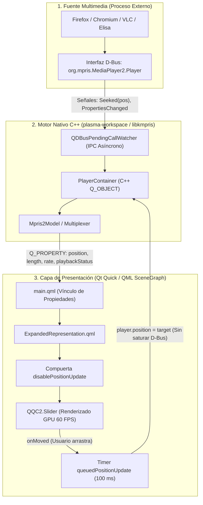
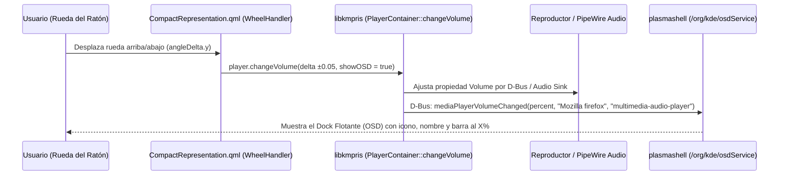

# Arquitectura del Reproductor Multimedia Nativo de KDE y Plan de Ingeniería para Groove Media Player

Este documento detalla la arquitectura interna del reproductor multimedia nativo de KDE Plasma (`org.kde.plasma.mediacontroller` + `libkmpris`), explica por qué el avance de su barra de reproducción funciona sin retardos ni tirones, y define el plan de implementación técnica para llevar esa misma arquitectura al **Reproductor Groove** ([`org.groove.mediaplayer`](file:///Volumes/HDEXTERNO/linux_groove/scripts/arch/native/files/usr/share/plasma/plasmoids/org.groove.mediaplayer/contents/ui/ExpandedRepresentation.qml)).

---

## Parte 1: ¿Cómo funciona el Reproductor Nativo de KDE Plasma?

El reproductor nativo de KDE Plasma no decodifica audio ni video por sí mismo; es un **controlador e interfaz reactiva sobre el protocolo estándar MPRIS2** (*Media Player Remote Interfacing Specification v2*) a través de **D-Bus**.

Su fluidez se basa en una **arquitectura de 3 capas desacopladas** donde la interfaz gráfica jamás espera respuestas bloqueantes del navegador o reproductor.

### 1.1 Diagrama de Arquitectura de 3 Capas



---

### 1.2 Los 4 Secretos Técnicos del Avance Sin Retardos (Zero-Lag)

#### 1. Extrapolación con Reloj Monotónico Local (Cero Polling por D-Bus)
Si un reproductor consultara por D-Bus cada 16 milisegundos (60 FPS): *"¿En qué microsegundo va el video?"*, saturaría el bus de mensajes del sistema operativo (IPC) y produciría micro-congelamientos en la barra de progreso.

En su lugar, la arquitectura nativa aplica física básica de movimiento uniforme:
1. Cuando la reproducción inicia, se pausa o salta de posición, el motor toma una **instantánea de anclaje**:
   - Posición base reportada en microsegundos: $P_0$
   - Marca de tiempo del reloj monotónico local en milisegundos: $t_0$
2. Mientras el estado sea `Playing`, en cada ciclo de actualización se calcula la posición en memoria local sin tocar D-Bus:
   $$P(t) = P_0 + (t_{\text{actual}} - t_0) \times 1000 \times \text{Rate}$$
3. Al depender del reloj monotónico real ($\Delta t = t_{\text{actual}} - t_0$) y no de sumar una constante fija en un `Timer`, **nunca acumula desfase (clock drift)** aunque el procesador esté ocupado.

#### 2. Sincronización Reactiva por Señales D-Bus (`Seeked` y `PropertiesChanged`)
El cálculo local solo se corrige cuando ocurre un evento real en el reproductor origen:
- **`Seeked(int64 Position)`**: Si el usuario adelanta el video directamente dentro de YouTube, Firefox emite la señal `Seeked`. `libkmpris` la captura e inmediatamente actualiza $(P_0, t_0)$.
- **`PropertiesChanged`**: Si el video cambia de estado (`Playing` $\leftrightarrow$ `Paused`), cambia su velocidad (`Rate`), o cambia los metadatos (`Metadata["mpris:length"]`), el contenedor C++ invoca `updatePosition()` de forma asíncrona mediante `QDBusPendingCallWatcher`.

#### 3. Desacoplamiento Bidireccional del Slider (`disablePositionUpdate` + `queuedPositionUpdate`)
Uno de los defectos más comunes en reproductores personalizados es el **"efecto resorte"**: el usuario intenta arrastrar la barra hacia adelante, pero antes de soltar el clic, el temporizador interno vuelve a colocar la barra en el segundo anterior.

El reproductor nativo de KDE lo resuelve en `ExpandedRepresentation.qml` con dos mecanismos combinados:
1. **Bandera `disablePositionUpdate`**: En el instante en que el usuario presiona el deslizador (`pressed == true`), el vínculo entrante desde el motor hacia el slider se congela. El usuario tiene control absoluto visual de la barra y de la etiqueta de tiempo.
2. **Cola `queuedPositionUpdate` (100 ms)**: Mientras el usuario mueve el ratón de izquierda a derecha, **no se envían cientos de comandos D-Bus por segundo**. Un temporizador de 100 ms agrupa el movimiento y envía la nueva posición (`player.position = value`) de forma limpia, liberando `disablePositionUpdate` solo cuando el reproductor confirma la recepción.

#### 4. Comportamiento de Navegadores Web (Firefox / Chromium) vs Reproductores Nativos
- **Reproductores de escritorio (VLC, Elisa):** Actualizan `Position` y `mpris:length` desde el frame 0.
- **Navegadores web (Firefox / YouTube):** Por optimización de procesos *sandbox*, Firefox no transmite cambios continuos de la propiedad `Position` por D-Bus mientras el video corre, y durante cambios de video en listas de reproducción de YouTube puede enviar primero el título nuevo con `mpris:length = 0` y reportar la duración real unos milisegundos después. Por eso es indispensable combinar `player.updatePosition()` con extrapolación local por reloj monotónico.

---

### 1.3 ¿Cómo funciona el Giro de Rueda (Scroll) y el Dock Flotante de Volumen (OSD) en el Reproductor Nativo?

Cuando pasas el cursor sobre el icono del reproductor nativo y giras la rueda del ratón (o deslizas con dos dedos en el touchpad), ocurren tres cosas en cadena dentro de KDE Plasma:



1. **Captura del giro (`WheelHandler` / `onWheel`):**
   En el icono del panel (`CompactRepresentation.qml`), KDE escucha el evento de desplazamiento vertical (`wheel.angleDelta.y`). Cada escalón equivale a un incremento o decremento del **5% (`±0.05`)**.
2. **Método nativo `player.changeVolume(delta, showOSD)` en `libkmpris`:**
   El contenedor C++ `PlayerContainer` expone el método invocable `changeVolume(double delta, bool showOSD)`.
3. **El Dock Flotante de Volumen (`org.kde.osdService`):**
   Ese recuadro flotante translúcido que muestra la nota musical, el título **`Mozilla firefox`** y la barra al **`100 %`** no es una ventana del reproductor, sino el **Servicio OSD (On-Screen Display)** nativo de `plasmashell`, invocado por D-Bus en la ruta `/org/kde/osdService` mediante el método:
   ```cpp
   void Osd::mediaPlayerVolumeChanged(int percent, const QString &playerName, const QString &playerIconName)
   ```
   - Si `percent == 0`, muestra el texto de silenciado (*"Mozilla firefox silenciado"*).
   - Si `percent > 0`, despliega el dock flotante con el icono de la aplicación, el nombre del reproductor y la barra de progreso con el porcentaje exacto.

> **¿Por qué en Firefox a veces el OSD nativo se queda marcando `100 %` aunque gires la rueda?**
> Porque en Linux muchos navegadores bloquean la escritura sobre su propiedad `org.mpris.MediaPlayer2.Player.Volume` y la reportan fija en `1.0` (`100%`). En nuestro **Reproductor Groove** podemos superar incluso al reproductor nativo: al girar la rueda ajustamos el volumen real en **PipeWire (`wpctl`)** y simultáneamente llamamos a `org.kde.osdService.mediaPlayerVolumeChanged` pasándole el porcentaje real (`0% - 100%`), haciendo que el dock flotante de KDE muestre siempre el nivel verdadero de audio.

---

## Parte 2: Diagnóstico Actual del Reproductor Groove

Al auditar nuestra implementación actual en [`ExpandedRepresentation.qml`](file:///Volumes/HDEXTERNO/linux_groove/scripts/arch/native/files/usr/share/plasma/plasmoids/org.groove.mediaplayer/contents/ui/ExpandedRepresentation.qml), identificamos **4 puntos clave de mejora** para igualar al 100% la suavidad y solidez del motor nativo:

| Componente | Estado Actual en Groove | Limitación Detectada | Solución Basada en Arquitectura KDE |
| :--- | :--- | :--- | :--- |
| **Cálculo de Avance** | [`positionPollTimer`](file:///Volumes/HDEXTERNO/linux_groove/scripts/arch/native/files/usr/share/plasma/plasmoids/org.groove.mediaplayer/contents/ui/ExpandedRepresentation.qml#L98-L123) suma `+250000` µs fijos cada tick de 250 ms | En QML los `Timer` no son de tiempo real estricto; sumar un valor fijo produce micro-saltos (4 FPS) y deriva de tiempo | Calcular $P(t) = P_0 + (Date.now() - t_0) \times 1000 \times \text{rate}$ a **100 ms (10 FPS)** o **60 ms (16 FPS)** con delta de reloj real |
| **Arrastre de Barra (Seek)** | [`onMoved`](file:///Volumes/HDEXTERNO/linux_groove/scripts/arch/native/files/usr/share/plasma/plasmoids/org.groove.mediaplayer/contents/ui/ExpandedRepresentation.qml#L484-L493) llama a `player.Seek(delta)` y `player.position` en cada píxel | Envolver ambos llamados sin *debounce* en cada píxel de arrastre satura a Firefox por D-Bus y causa retardos | Implementar `disablePositionUpdate` + `queuedPositionUpdate` (100 ms) idéntico al reproductor nativo |
| **Sondeo de Duración en YouTube** | [`firefoxLengthProbeTimer`](file:///Volumes/HDEXTERNO/linux_groove/scripts/arch/native/files/usr/share/plasma/plasmoids/org.groove.mediaplayer/contents/ui/ExpandedRepresentation.qml#L136-L157) hace `Pause()` y `Play()` si `length == 0` | Provoca un corte audible de 120 ms al cambiar de video en YouTube | Usar un sondeo no intrusivo llamando únicamente a `player.updatePosition()` y leyendo `player.length` sin pausar el audio |
| **Atajos de Teclado y Rueda** | Solo clic con ratón | No permite pausar con `Espacio`/`K`, adelantar con `Flechas`/`J`/`L`, ni ajustar volumen con la rueda del ratón | Integrar manejadores de teclado y `WheelHandler` en barra de progreso y píldora de volumen |

---

## Parte 3: Plan de Implementación Paso a Paso para el Reproductor Groove

### Fase 1: Motor de Reloj Monotónico sin Deriva (`Anchor Clock Engine`)
En [`ExpandedRepresentation.qml`](file:///Volumes/HDEXTERNO/linux_groove/scripts/arch/native/files/usr/share/plasma/plasmoids/org.groove.mediaplayer/contents/ui/ExpandedRepresentation.qml):
1. Reemplazar el acumulador incremental por variables de anclaje temporal:
   - `property real anchorPositionUs: 0` (Posición base $P_0$ en microsegundos)
   - `property double anchorTimestampMs: 0` (Reloj base $t_0$ obtenido con `Date.now()`)
   - `property bool disablePositionUpdate: false` (Compuerta de protección durante interacción del usuario)
2. Crear la función `reanchorPosition(newPosUs)`:
   ```qml
   function reanchorPosition(newPosUs) {
       expandedRoot.anchorPositionUs = Math.max(0, newPosUs);
       expandedRoot.anchorTimestampMs = Date.now();
       if (!expandedRoot.disablePositionUpdate) {
           expandedRoot.livePosition = expandedRoot.anchorPositionUs;
       }
   }
   ```
3. Configurar el reloj de interpolación visual a **100 ms** calculando el tiempo real transcurrido:
   ```qml
   var elapsedUs = (Date.now() - expandedRoot.anchorTimestampMs) * 1000.0 * rate;
   var nextPos = expandedRoot.anchorPositionUs + elapsedUs;
   ```
   - Cada 2 segundos (20 ticks), invocar silenciosamente `player.updatePosition()` para que `libkmpris` consulte a D-Bus en segundo plano y mantenga el reloj alineado con el stream real de audio.

### Fase 2: Slider Desacoplado con Cola Asíncrona (`queuedPositionUpdate`)
1. Añadir el temporizador de *debounce* idéntico al reproductor oficial de KDE Plasma:
   ```qml
   Timer {
       id: queuedPositionUpdate
       interval: 100
       repeat: false
       onTriggered: {
           if (!expandedRoot.player || !expandedRoot.player.canSeek) {
               expandedRoot.disablePositionUpdate = false;
               return;
           }
           var targetUs = Math.round(progressSlider.value);
           expandedRoot.reanchorPosition(targetUs);
           expandedRoot.player.position = targetUs;
           seekReleaseGuardTimer.restart();
       }
   }
   ```
2. Cuando el usuario arrastra o mueve `progressSlider`:
   - Activar `expandedRoot.disablePositionUpdate = true`.
   - Reiniciar `queuedPositionUpdate.restart()` en lugar de bombardear D-Bus en cada píxel.
   - Al soltar el control (`onPressedChanged`), liberar suavemente `disablePositionUpdate` tras confirmar la nueva posición.

### Fase 3: Sondeo No Intrusivo de Duración (`lengthProbeTimer`)
1. Eliminar por completo el `Pause()` / `Play()` de `firefoxLengthProbeTimer` para que la reproducción jamás sufra cortes audibles.
2. En su lugar, implementar un `Timer` ligero que, cuando detecte una pista recién cargada con `length <= 0`, invoque `player.updatePosition()` cada 400 ms (hasta un máximo de 6 intentos) hasta que el navegador publique el metadato `mpris:length`.

### Fase 4: Giro de Rueda (Scroll) con Dock Flotante OSD Nativo y Atajos de Teclado
1. **Puente directo con el Dock Flotante de KDE (`showNativeVolumeOsd`):**
   Crear en `ExpandedRepresentation.qml` y `CompactRepresentation.qml` la función que ajusta el volumen real en PipeWire + MPRIS e invoca el OSD oficial de KDE Plasma (`org.kde.osdService.mediaPlayerVolumeChanged`):
   ```qml
   function adjustVolumeWithOsd(deltaStep) {
       var nextVol = Math.min(1.0, Math.max(0.0, (expandedRoot.systemMuted ? 0.0 : expandedRoot.systemVolume) + deltaStep));
       expandedRoot.setRealVolume(nextVol);
       var pct = Math.round(nextVol * 100);
       var appName = (expandedRoot.player && expandedRoot.player.identity) ? expandedRoot.player.identity : "Reproductor Groove";
       // Dispara el dock flotante nativo de KDE Plasma con el porcentaje real
       audioExec.connectSource(
           "qdbus6 org.kde.plasmashell /org/kde/osdService org.kde.osdService.mediaPlayerVolumeChanged "
           + pct + " \"" + appName.replace(/"/g, "") + "\" \"multimedia-audio-player\""
       );
   }
   ```
2. **Desplazamiento (Scroll) en toda la ventana de Groove y en el icono del panel:**
   - Agregar un `WheelHandler` global en la ventana de `ExpandedRepresentation.qml` (y actualizar `CompactRepresentation.qml`) para que al girar la rueda del ratón en cualquier parte de la ventana del Reproductor Groove (o sobre su icono en la barra):
     - Suba o baje el volumen real en pasos de `5%` (`±0.05`).
     - Mueva en tiempo real la barra de volumen interna de Groove.
     - Muestre en pantalla el **Dock Flotante de Volumen (OSD) nativo de KDE Plasma** con el nombre del reproductor (`Mozilla firefox`) y el porcentaje exacto actualizado.
   - Mejorar también el `ToolTip` del icono compacto para indicar: *"Pulse con el botón central para pausar / Desplace para ajustar el volumen"*.
3. **Atajos de teclado estilo reproductor nativo / YouTube:**
   - `Espacio` o `K`: Reproducir / Pausar (`PlayPause()`).
   - `Flecha Izquierda` o `J`: Retroceder 5 segundos (`Seek(-5000000)`).
   - `Flecha Derecha` o `L`: Adelantar 5 segundos (`Seek(5000000)`).
   - `Flecha Arriba` / `Flecha Abajo`: Subir / Bajar volumen `+5%` / `-5%` mostrando el Dock Flotante OSD.

### Fase 5: Jerarquía de Botones de Transporte y Badge de Ondas de 5 Barras

#### 1. Nueva Jerarquía de Botones de Transporte
Para que el círculo de hover traslúcido envuelva holgadamente cada botón sin bordes apretados:
* **Play / Pause (Centro):** Tamaño rey con contenedor circular de `42px` y tamaño de icono de `24px`.
* **Anterior / Siguiente (Skip):** Contenedor circular de `32px` y tamaño de icono reducido a **`17px`**. Con esto se consigue un margen libre de **7.5px** alrededor del icono, logrando que el círculo de hover cubra el botón con perfecta holgura.
* **Aleatorio / Repetir (Bordes):** Contenedor circular de `28px` con icono de `14px`.

#### 2. Badge de Ondas de Audio de 5 Barras (Estilo Apple Now Playing)
Ubicado en la sección de carátula/metadatos (Hero Section) con dos estados claramente diferenciados:
* **En Reproducción (Acción):** 5 barritas verticales redondeadas (*pills*) de `2.5px` de ancho con radio de `1.25px`, oscilando suavemente a 30 FPS entre `4px` y `16px` con desfasaje senoidal orgánico.
* **En Pausa (Colapsado):** Las 5 barritas se contraen suavemente mediante `Behavior on height` hasta convertirse en **5 pequeños puntos cuadrados redondeados de `2.5px × 2.5px` (`▪ ▪ ▪ ▪ ▪`)** con opacidad atenuada, idéntico a la referencia visual provista por el usuario.

### Fase 6: Despliegue en Caliente y Sincronización para ISO 0.4.2
1. Aplicar los cambios en [`ExpandedRepresentation.qml`](file:///Volumes/HDEXTERNO/linux_groove/scripts/arch/native/files/usr/share/plasma/plasmoids/org.groove.mediaplayer/contents/ui/ExpandedRepresentation.qml) y [`CompactRepresentation.qml`](file:///Volumes/HDEXTERNO/linux_groove/scripts/arch/native/files/usr/share/plasma/plasmoids/org.groove.mediaplayer/contents/ui/CompactRepresentation.qml).
2. Inyectar en caliente en la máquina virtual activa con [`deploy_groove_player_live.py`](file:///Volumes/HDEXTERNO/linux_groove/scripts/deploy_groove_player_live.py) y verificar en tiempo real con Firefox/YouTube.
3. Sincronizar el archivo actualizado dentro del rootfs de construcción (`/tmp/groove-native-root-0.4.1-rc1`) y registrar el commit en Git.

