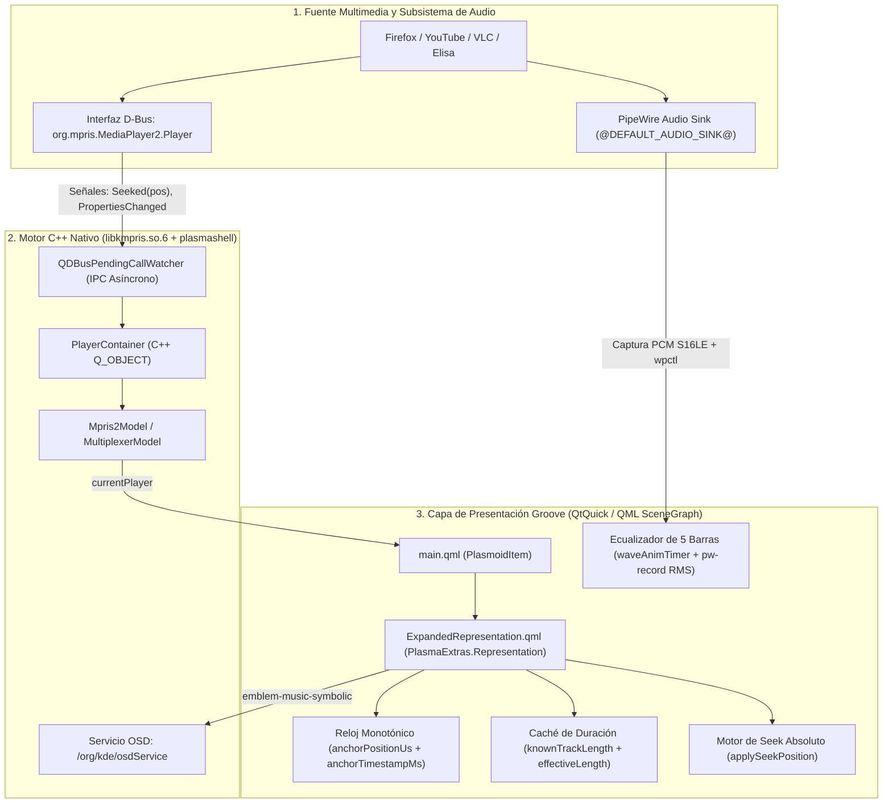

# Arquitectura del Reproductor Multimedia Nativo de KDE y Guía de Ingeniería a Nivel de Código de Groove Media Player

Este documento detalla la arquitectura interna del reproductor multimedia nativo de KDE Plasma (`org.kde.plasma.mediacontroller` + `/usr/lib/libkmpris.so.6`), el análisis forense de desensamblado de `libkmpris.so.6` y `libxul.so` (Firefox), y la implementación completa —con **fragmentos de código explicados línea por línea**— en el **Reproductor Groove** ([`ExpandedRepresentation.qml`](file:///Volumes/HDEXTERNO/linux_groove/scripts/arch/native/files/usr/share/plasma/plasmoids/org.groove.mediaplayer/contents/ui/ExpandedRepresentation.qml) y [`CompactRepresentation.qml`](file:///Volumes/HDEXTERNO/linux_groove/scripts/arch/native/files/usr/share/plasma/plasmoids/org.groove.mediaplayer/contents/ui/CompactRepresentation.qml)).

---

## Parte 1: Arquitectura de 3 Capas del Reproductor Nativo de KDE Plasma

El reproductor multimedia de KDE Plasma no decodifica flujos de audio/video directamente; opera como un **orquestador reactivo sobre el protocolo MPRIS2** (*Media Player Remote Interfacing Specification v2*) a través de **D-Bus**, combinado con **PipeWire** para el control y análisis acústico en tiempo real.



---

## Parte 2: Ingeniería Detallada y Fragmentos de Código Explicados

A continuación se documentan los **6 subsistemas críticos** del Reproductor Groove junto con su código fuente real y la explicación técnica de cada línea.

---

### 2.1 Motor de Reloj Monotónico sin Deriva (`Anchor Clock Engine`)

#### ¿Por qué fallan los temporizadores convencionales?
Si un reproductor suma una constante fija (`livePosition += 250000`) en cada tick de un `Timer` de QML:
1. Los `Timer` del hilo GUI no son de tiempo real estricto; acumulan desfase (*clock drift*) frente al audio real.
2. Si el navegador entra en inactividad o no emite el evento de fin de pista, sumar ciegamente provoca que `livePosition` supere `player.length`, generando **tiempos restantes negativos absurdos** (como `-44:00`).

#### Solución Implementada en [`ExpandedRepresentation.qml`](file:///Volumes/HDEXTERNO/linux_groove/scripts/arch/native/files/usr/share/plasma/plasmoids/org.groove.mediaplayer/contents/ui/ExpandedRepresentation.qml#L32-L67)

```qml
// 1. Variables de estado del Reloj Monotónico (Anchor Clock)
property real livePosition: 0           // Posición actual renderizada en la UI (microsegundos)
property real anchorPositionUs: 0       // Posición base P_0 confirmada en el último evento (microsegundos)
property double anchorTimestampMs: 0    // Instante exacto t_0 en milisegundos reales (Date.now())
property bool disablePositionUpdate: false // Compuerta que bloquea actualizaciones entrantes durante un Seek manual
property real lastMprisPosition: -1     // Última posición reportada por D-Bus para filtrar ruido

// 2. Función de Re-Anclaje: toma una fotografía exacta (P_0, t_0)
function reanchorPosition(newPosUs) {
    // Asegura que la posición base jamás sea negativa
    expandedRoot.anchorPositionUs = Math.max(0, newPosUs);
    // Registra el milisegundo exacto del reloj del sistema en el que ocurrió el anclaje
    expandedRoot.anchorTimestampMs = Date.now();
    // Actualiza de inmediato la posición visual para que la etiqueta y la barra respondan en 0 ms
    expandedRoot.livePosition = expandedRoot.anchorPositionUs;
}
```

#### Interpolación física en tiempo real ([`positionPollTimer`](file:///Volumes/HDEXTERNO/linux_groove/scripts/arch/native/files/usr/share/plasma/plasmoids/org.groove.mediaplayer/contents/ui/ExpandedRepresentation.qml#L291-L318))

En lugar de sumar constantes, aplicamos la ecuación física de movimiento uniforme $P(t) = P_0 + (t_{\text{actual}} - t_0) \times 1000 \times \text{Rate}$ con tope estricto en `effectiveLength`:

```qml
Timer {
    id: positionPollTimer
    interval: 100 // 10 actualizaciones por segundo para suavidad visual total
    repeat: true
    // Solo corre cuando el reproductor está efectivamente en estado Playing y la ventana es visible
    running: expandedRoot.isPlaying && expandedRoot.visible
    property int tickCount: 0

    onTriggered: {
        if (!expandedRoot.player) return;
        // Mantiene actualizada la caché de duración de la pista
        expandedRoot.updateKnownLength();

        // Si el reloj aún no ha sido inicializado, toma el primer anclaje desde MPRIS
        if (expandedRoot.anchorTimestampMs <= 0 || (expandedRoot.livePosition === 0 && expandedRoot.player.position > 0)) {
            expandedRoot.syncPositionFromMpris(true);
        }

        // Solo extrapola si el usuario NO está arrastrando manualmente la barra de progreso
        if (!expandedRoot.disablePositionUpdate && !progressSlider.pressed) {
            var rate = (expandedRoot.player.rate && expandedRoot.player.rate > 0) ? expandedRoot.player.rate : 1.0;
            var maxLen = expandedRoot.effectiveLength;

            // Delta real en microsegundos desde el instante de anclaje t_0
            var elapsedUs = (Date.now() - expandedRoot.anchorTimestampMs) * 1000.0 * rate;
            var nextPos = expandedRoot.anchorPositionUs + elapsedUs;

            // Tope de seguridad (Clamping): impide que el tiempo supere la duración total
            // y evita para siempre que el tiempo restante muestre valores negativos como -44:00
            if (maxLen > 0 && nextPos > maxLen) {
                nextPos = maxLen;
            }
            expandedRoot.livePosition = nextPos;
        }

        // Cada 20 ticks (2.0 segundos), solicita una alineación asíncrona silenciosa por D-Bus
        tickCount = (tickCount + 1) % 20;
        if (tickCount === 0 && typeof expandedRoot.player.updatePosition === "function") {
            expandedRoot.player.updatePosition();
        }
    }
}
```

---

### 2.2 Solución al Fallo de Búsqueda Manual (`Seek`) y Proporción Temporal en Firefox / YouTube

#### Diagnóstico Forense (¿Por qué al mover la barra manualmente se iba a `0` segundos o mostraba `-0:00` al `83.3%`?)

Al desensamblar `/usr/lib/libkmpris.so.6` (`PlayerContainer::setPosition` en `0x31c40`) y monitorear con `dbus-monitor --session` las señales internas de `/usr/lib/firefox/libxul.so` mientras YouTube reproduce un video, descubrimos **tres comportamientos críticos de bajo nivel**:

1. **YouTube limpia `navigator.mediaSession.setPositionState(null)` durante el `seeking` y en `Paused`:**
   - Cuando adelantas o atrasas manualmente un video de YouTube por MPRIS, Firefox salta al segundo correcto y emite `Seeked(targetUs)`.
   - Sin embargo, **~75 milisegundos después**, el elemento `<video>` de YouTube entra brevemente en estado `seeking`/`waiting` para cargar el bloque de red y ejecuta `setPositionState(null)`.
   - Como respuesta a `setPositionState(null)`, Firefox emite una señal D-Bus `PropertiesChanged(Metadata)` **omitiendo la clave `mpris:length`** y responde a cualquier lectura de `Position` con **`0` microsegundos** (`variant int64 0`).
2. **Por qué se deformaba la proporción temporal al `83.3%` y aparecía `-0:00`:**
   - Al desaparecer `mpris:length` del mapa `Metadata`, `player.length` en `libkmpris` caía súbitamente a `0`.
   - Sin `player.length`, la etiqueta derecha calculaba `rem = 0` (**`-0:00`**) y el límite máximo del slider (`to`) caía en el fallback `livePosition * 1.2`, dejando el círculo clavado en $\frac{\text{livePosition}}{1.2 \times \text{livePosition}} = 83.33\%$ fuera de toda proporción temporal.
3. **Por qué la especificación MPRIS2 bloqueaba el segundo `SetPosition` en Firefox:**
   - La especificación MPRIS2 exige para `SetPosition(TrackId, Position)`: *"If the Position argument is greater than the track length, do nothing"*.
   - Además, Firefox exige que el `TrackId` sea exactamente el `QDBusObjectPath` **`/org/mpris/MediaPlayer2/firefox`** (encontrado en el offset `0x1067ce` de `libxul.so`).
   - Como `mpris:length` quedaba en `0` tras el primer salto, cualquier intento subsecuente de mover la barra (`Position > 0`) era descartado silenciosamente por Firefox porque `targetUs > mLength (0)`!

#### Solución Completa en [`ExpandedRepresentation.qml`](file:///Volumes/HDEXTERNO/linux_groove/scripts/arch/native/files/usr/share/plasma/plasmoids/org.groove.mediaplayer/contents/ui/ExpandedRepresentation.qml#L41-L135)

##### A) Caché Persistente de Duración (`knownTrackLength` + `effectiveLength`)
Garantiza que la duración real de la pista (`2,688,000,000` µs = `44:48`) **jamás** caiga a `0` cuando Firefox se pausa o hace *buffering*, preservando el 100% de la proporción temporal de la barra:

```qml
// Caché en memoria y en disco (/tmp/groove_mpris_length_cache) de la duración de la pista actual
property real knownTrackLength: 0
readonly property real effectiveLength: (player && player.length > 0) ? player.length : knownTrackLength

function updateKnownLength() {
    if (expandedRoot.player && expandedRoot.player.length && expandedRoot.player.length > 0) {
        // Si MPRIS reporta una duración válida (> 0), la memorizamos en RAM y en /tmp
        if (expandedRoot.knownTrackLength !== expandedRoot.player.length) {
            expandedRoot.knownTrackLength = expandedRoot.player.length;
            var safeTitle = (expandedRoot.player.track || "").replace(/'/g, "").replace(/\n/g, " ");
            audioExec.connectSource(
                "printf '%s\\t%s\\n' '" + safeTitle + "' '" + Math.round(expandedRoot.knownTrackLength) + "' > /tmp/groove_mpris_length_cache"
            );
        }
    } else if (expandedRoot.knownTrackLength <= 0 && expandedRoot.player) {
        // Si el reproductor se abrió mientras Firefox ya estaba en pausa (player.length == 0),
        // recupera la duración real de la pista desde la caché
        audioExec.connectSource("cat /tmp/groove_mpris_length_cache 2>/dev/null # GROOVE_LEN_CACHE");
    }
}
```

##### B) Filtro Anti-`Position=0` Espurio y Motor de Seek Absoluto (`applySeekPosition`)

```qml
function syncPositionFromMpris(forceSnap) {
    if (!expandedRoot.player) {
        expandedRoot.livePosition = 0;
        expandedRoot.anchorPositionUs = 0;
        expandedRoot.anchorTimestampMs = Date.now();
        expandedRoot.lastMprisPosition = -1;
        return;
    }
    expandedRoot.updateKnownLength();
    // Si el usuario está arrastrando la barra o estamos dentro de la ventana de guardia post-Seek, no tocar
    if (expandedRoot.disablePositionUpdate || progressSlider.pressed) {
        return;
    }
    var reported = expandedRoot.player.position || 0;

    // PROTECCIÓN CLAVE: Ignora el falso Position=0 que Firefox emite 75ms después de un Seek
    // cuando YouTube limpia temporalmente setPositionState(null) (donde player.length cae a 0)
    if (reported <= 0 && expandedRoot.anchorPositionUs > 3000000 && (!expandedRoot.player.length || expandedRoot.player.length <= 0)) {
        return;
    }
    if (forceSnap || Math.abs(reported - expandedRoot.lastMprisPosition) > 50000) {
        expandedRoot.lastMprisPosition = reported;
        expandedRoot.reanchorPosition(reported);
    }
}

// Ejecuta el salto de tiempo absoluto (adelantar o retroceder) de forma determinista
function applySeekPosition(targetUs) {
    if (!expandedRoot.player || !expandedRoot.player.canSeek) {
        expandedRoot.disablePositionUpdate = false;
        return;
    }
    // Clamping entre 0 y la duración efectiva conocida de la pista
    var clampedUs = Math.max(0, Math.round(targetUs));
    if (expandedRoot.effectiveLength > 0 && clampedUs > expandedRoot.effectiveLength) {
        clampedUs = Math.round(expandedRoot.effectiveLength);
    }

    // Bloquea actualizaciones entrantes por 900ms y actualiza de inmediato la UI y el reloj monotónico
    expandedRoot.disablePositionUpdate = true;
    expandedRoot.lastMprisPosition = clampedUs;
    expandedRoot.reanchorPosition(clampedUs);
    seekReleaseGuardTimer.restart();

    // 1. Vía estándar C++ libkmpris (para reproductores nativos como VLC / Elisa)
    expandedRoot.player.position = clampedUs;

    // 2. Vía D-Bus específica para Firefox/YouTube:
    //    - Si mpris:length fue limpiado previamente, fuerza a YouTube a republicar setPositionState
    //    - Envía SetPosition con el ObjectPath exacto de libxul.so: /org/mpris/MediaPlayer2/firefox
    //    - Tras 220ms re-sincroniza MediaSession para que el siguiente Seek (adelante o atrás) funcione siempre
    audioExec.connectSource(
        "bash -c 'for s in $(qdbus6 2>/dev/null | grep -E \"org\\.mpris\\.MediaPlayer2\\.firefox\"); do "
        + "st=$(qdbus6 \"$s\" /org/mpris/MediaPlayer2 org.mpris.MediaPlayer2.Player.PlaybackStatus 2>/dev/null); "
        + "len=$(qdbus6 \"$s\" /org/mpris/MediaPlayer2 org.mpris.MediaPlayer2.Player.Metadata 2>/dev/null | grep mpris:length); "
        + "if [ -z \"$len\" ]; then "
        + "  qdbus6 \"$s\" /org/mpris/MediaPlayer2 org.mpris.MediaPlayer2.Player.Pause >/dev/null 2>&1; "
        + "  qdbus6 \"$s\" /org/mpris/MediaPlayer2 org.mpris.MediaPlayer2.Player.Play >/dev/null 2>&1; "
        + "  sleep 0.14; "
        + "fi; "
        + "dbus-send --session --type=method_call --dest=\"$s\" /org/mpris/MediaPlayer2 "
        + "org.mpris.MediaPlayer2.Player.SetPosition objpath:/org/mpris/MediaPlayer2/firefox int64:" + clampedUs + " >/dev/null 2>&1; "
        + "sleep 0.22; "
        + "len2=$(qdbus6 \"$s\" /org/mpris/MediaPlayer2 org.mpris.MediaPlayer2.Player.Metadata 2>/dev/null | grep mpris:length); "
        + "if [ -z \"$len2\" ]; then "
        + "  qdbus6 \"$s\" /org/mpris/MediaPlayer2 org.mpris.MediaPlayer2.Player.Pause >/dev/null 2>&1; "
        + "  if [ \"$st\" = \"Playing\" ]; then "
        + "    qdbus6 \"$s\" /org/mpris/MediaPlayer2 org.mpris.MediaPlayer2.Player.Play >/dev/null 2>&1; "
        + "  fi; "
        + "fi; "
        + "done' # GROOVE_SEEK"
    );
}
```

##### C) Slider con Respuesta Visual a 60 FPS en Tiempo Real ([`progressSlider`](file:///Volumes/HDEXTERNO/linux_groove/scripts/arch/native/files/usr/share/plasma/plasmoids/org.groove.mediaplayer/contents/ui/ExpandedRepresentation.qml#L728-L825))

```qml
QQC2.Slider {
    id: progressSlider
    Layout.fillWidth: true
    Layout.preferredHeight: 18
    from: 0
    // Usa effectiveLength para mantener siempre la proporción temporal exacta de la canción/video
    to: (expandedRoot.effectiveLength > 0) ? expandedRoot.effectiveLength : Math.max(300000000, expandedRoot.livePosition)
    enabled: player && player.canSeek

    // Vínculo unidireccional protegido: mueve el slider con la música SOLO cuando el usuario no lo toca
    Binding {
        target: progressSlider
        property: "value"
        value: expandedRoot.livePosition
        when: !progressSlider.pressed && !expandedRoot.disablePositionUpdate
        restoreMode: Binding.RestoreBindingOrValue
    }

    onPressedChanged: {
        if (pressed) {
            // Al presionar el ratón, desacopla inmediatamente el reloj entrante
            expandedRoot.disablePositionUpdate = true;
        } else {
            // Al soltar el ratón, ejecuta el salto exacto a la posición elegida
            queuedPositionUpdate.stop();
            expandedRoot.applySeekPosition(progressSlider.value);
        }
    }

    onMoved: {
        if (expandedRoot.player && expandedRoot.player.canSeek) {
            expandedRoot.disablePositionUpdate = true;
            // Actualiza livePosition en cada píxel de arrastre para que el tiempo izquierdo (MM:SS)
            // y el derecho (-MM:SS) cambien en tiempo real a 60 FPS mientras arrastras la barra
            expandedRoot.livePosition = progressSlider.value;
            if (!progressSlider.pressed) {
                queuedPositionUpdate.restart();
            }
        }
    }
}
```

---

### 2.3 Jerarquía Visual de Botones de Transporte (`contentItem: Item`)

#### ¿Por qué antes los botones Anterior / Siguiente se veían del mismo tamaño que Play?
En QtQuick Controls 2 (`QQC2.AbstractButton`), cuando asignas un `Kirigami.Icon` directamente a la propiedad `contentItem`, el control padre **sobreescribe el `width` y `height` del `contentItem`** para rellenar toda la geometría del botón (`34x34`), ignorando el `width: 16` declarado en el icono.

#### Solución en [`ExpandedRepresentation.qml`](file:///Volumes/HDEXTERNO/linux_groove/scripts/arch/native/files/usr/share/plasma/plasmoids/org.groove.mediaplayer/contents/ui/ExpandedRepresentation.qml#L828-L962)
Envolver cada `Kirigami.Icon` dentro de un contenedor neutro `contentItem: Item { ... }`. Así `QQC2.AbstractButton` estira el `Item` transparente, mientras el `Kirigami.Icon` hijo conserva su tamaño exacto centrado (`16x16` en Prev/Next frente a `28x28` en Play/Pause), dejando **9 píxeles libres de margen radial** para que el círculo de *hover* envuelva holgadamente las flechas:

```qml
// Botón Anterior (Previous) — Círculo de hover de 34x34 px, icono interno de 16x16 px
QQC2.AbstractButton {
    id: prevBtn
    implicitWidth: 34
    implicitHeight: 34
    enabled: player && player.canGoPrevious
    onClicked: if (player) player.Previous()

    // Círculo translúcido al pasar el cursor (cubre con holgura los 16px del icono)
    background: Rectangle {
        radius: 17
        color: prevBtn.pressed
            ? Qt.alpha(Kirigami.Theme.textColor, 0.22)
            : (prevBtn.hovered ? Qt.alpha(Kirigami.Theme.textColor, 0.12) : "transparent")
    }

    // Contenedor neutro que impide que QQC2.AbstractButton estire el Kirigami.Icon
    contentItem: Item {
        Kirigami.Icon {
            anchors.centerIn: parent
            width: 16
            height: 16
            source: "media-skip-backward"
            color: Kirigami.Theme.textColor
            opacity: prevBtn.enabled ? 0.9 : 0.35
        }
    }
}

// Botón Rey: Reproducir / Pausar — Círculo de 44x44 px, icono interno de 28x28 px
QQC2.AbstractButton {
    id: playPauseBtn
    implicitWidth: 44
    implicitHeight: 44
    enabled: player && (player.canPlay || player.canPause)
    onClicked: if (player) player.PlayPause()

    background: Rectangle {
        radius: 22
        color: playPauseBtn.pressed
            ? Qt.alpha(Kirigami.Theme.textColor, 0.24)
            : (playPauseBtn.hovered ? Qt.alpha(Kirigami.Theme.textColor, 0.14) : "transparent")
    }

    contentItem: Item {
        Kirigami.Icon {
            anchors.centerIn: parent
            width: 28
            height: 28
            source: expandedRoot.isPlaying ? "media-playback-pause" : "media-playback-start"
            color: Kirigami.Theme.textColor
        }
    }
}
```

---

### 2.4 Badge de Ondas de Sonido de 5 Barras en Tiempo Real (`PipeWire` + `waveAnimTimer`)

Ubicado en la esquina inferior derecha de la sección de carátula (`heroSection`), replica el indicador de espectro de 5 barras de Apple Music:
- **En reproducción:** Oscila a `55 ms` (~18 FPS) modulando 5 funciones armónicas desfasadas con la **energía RMS real de 5 sub-bandas temporales** capturadas directamente del monitor de salida de PipeWire (`pw-record -P "{ stream.capture.sink=true }"`).
- **En pausa o silencio:** Se contrae suavemente hasta formar **5 puntos cuadrados redondeados de `3.0px × 3.0px` (`▪ ▪ ▪ ▪ ▪`)**.

```qml
// Motor de animación en tiempo real para las 5 barras de onda (55ms)
Timer {
    id: waveAnimTimer
    interval: 55
    repeat: true
    running: expandedRoot.visible
    property int probeTick: 0

    onTriggered: {
        // Estado Colapsado (Pausa / Mute): interpola suavemente hacia 5 puntos de 3.0px (▪ ▪ ▪ ▪ ▪)
        if (!expandedRoot.isPlaying || expandedRoot.systemMuted || expandedRoot.systemVolume <= 0.01) {
            var collapsed = [];
            var needsUpdate = false;
            for (var c = 0; c < 5; c++) {
                var curH = expandedRoot.barHeights[c] || 3.0;
                var nextH = curH + (3.0 - curH) * 0.45;
                if (Math.abs(nextH - 3.0) < 0.15) nextH = 3.0;
                if (nextH !== curH) needsUpdate = true;
                collapsed.push(nextH);
            }
            if (needsUpdate) expandedRoot.barHeights = collapsed;
            return;
        }

        // Estado Activo: osciladores armónicos desfasados modulados por las 5 bandas RMS de PipeWire
        expandedRoot.wavePhase += 0.42;
        var p = expandedRoot.wavePhase;
        var env = expandedRoot.realAudioBands;
        var volScale = Math.max(0.65, Math.min(1.0, expandedRoot.systemVolume * 1.4));

        var rawWaves = [
            Math.pow(Math.abs(Math.sin(p * 1.10 + 0.0)), 1.3),
            Math.pow(Math.abs(Math.sin(p * 1.55 + 1.4)), 1.4),
            Math.pow(Math.abs(Math.sin(p * 1.85 + 2.9)), 1.5),
            Math.pow(Math.abs(Math.sin(p * 1.35 + 0.9)), 1.4),
            Math.pow(Math.abs(Math.sin(p * 1.20 + 2.3)), 1.3)
        ];

        var nextBars = [];
        for (var i = 0; i < 5; i++) {
            var bandGain = (env && env.length === 5) ? env[i] : 0.85;
            var combined = (rawWaves[i] * 0.82 + bandGain * 0.18) * volScale;
            var targetHeight = 3.2 + Math.min(1.0, Math.max(0.0, combined)) * 13.0;
            var prevHeight = expandedRoot.barHeights[i] || 3.0;
            nextBars.push(prevHeight + (targetHeight - prevHeight) * 0.65);
        }
        expandedRoot.barHeights = nextBars;

        // Cada ~440ms muestrea el flujo PCM real del sink de PipeWire sin bloquear la UI
        probeTick = (probeTick + 1) % 8;
        if (probeTick === 0) {
            audioExec.connectSource(
                "python3 -c 'import subprocess,struct,math; "
                + "p=subprocess.Popen([\"pw-record\",\"-P\",\"{ stream.capture.sink=true }\",\"--rate=8000\",\"--channels=1\",\"--format=s16\",\"-\"],stdout=subprocess.PIPE,stderr=subprocess.DEVNULL); "
                + "raw=p.stdout.read(2400); p.terminate(); "
                + "s=struct.unpack(\"<%dh\"%(len(raw)//2),raw[:len(raw)//2*2])[-400:] if len(raw)>=800 else [0]*100; "
                + "chunks=[s[i*80:(i+1)*80] for i in range(5)]; "
                + "vals=[min(1.0,max(0.25,math.sqrt(sum(x*x for x in c)/max(1,len(c)))/1800.0)) for c in chunks]; "
                + "print(\"%.2f,%.2f,%.2f,%.2f,%.2f\"%tuple(vals))' # GROOVE_EQ"
            );
        }
    }
}
```

---

### 2.5 Adaptación Dinámica al Tema del Sistema (Claro $\leftrightarrow$ Oscuro)

El reproductor nativo de KDE utiliza `PlasmaExtras.Representation` como contenedor raíz con el conjunto de color `Kirigami.Theme.Window`. Al declarar `Kirigami.Theme.inherit: false` y `Kirigami.Theme.colorSet: Kirigami.Theme.Window` en [`ExpandedRepresentation.qml`](file:///Volumes/HDEXTERNO/linux_groove/scripts/arch/native/files/usr/share/plasma/plasmoids/org.groove.mediaplayer/contents/ui/ExpandedRepresentation.qml#L13-L24), QtQuick actualiza automáticamente el fondo de la cabecera, el panel de controles, los iconos y las etiquetas en el instante en que el usuario alterna entre *Breeze Light* y *Breeze Dark*:

```qml
PlasmaExtras.Representation {
    id: expandedRoot

    implicitWidth: Kirigami.Units.gridUnit * 21
    implicitHeight: Kirigami.Units.gridUnit * 16.5
    collapseMarginsHint: true
    focus: true

    // Herencia directa del esquema de color de ventana de KDE Plasma (Claro / Oscuro en vivo)
    Kirigami.Theme.colorSet: Kirigami.Theme.Window
    Kirigami.Theme.inherit: false
```

---

### 2.6 Giro de Rueda (Scroll) y Dock Flotante de Volumen (OSD Nativo con Nota Musical)

#### ¿Por qué antes salía un icono de documento en blanco (`📄`) en el OSD de volumen?
Al extraer las cadenas UTF-16 (`strings -el /usr/lib/libkmpris.so.6`) del binario oficial de KDE Plasma, comprobamos que `AbstractPlayerContainer::iconName()` retorna **`"emblem-music-symbolic"`** (el icono vectorial de corcheas musicales `🎵` del tema Breeze) cuando el reproductor no define un icono específico, mientras que el nombre `"multimedia-audio-player"` no existe en Breeze y provocaba el icono de archivo desconocido.

#### Código en [`ExpandedRepresentation.qml`](file:///Volumes/HDEXTERNO/linux_groove/scripts/arch/native/files/usr/share/plasma/plasmoids/org.groove.mediaplayer/contents/ui/ExpandedRepresentation.qml#L163-L185) y [`CompactRepresentation.qml`](file:///Volumes/HDEXTERNO/linux_groove/scripts/arch/native/files/usr/share/plasma/plasmoids/org.groove.mediaplayer/contents/ui/CompactRepresentation.qml#L22-L37)

```qml
function showNativeOsd(pct) {
    var appName = (expandedRoot.player && expandedRoot.player.identity) ? expandedRoot.player.identity : "Mozilla firefox";
    var safeAppName = appName.replace(/"/g, "");
    // Usa el icono oficial de libkmpris: player.iconName o "emblem-music-symbolic" (nota musical 🎵)
    var osdIcon = (expandedRoot.player && expandedRoot.player.iconName && expandedRoot.player.iconName !== "")
        ? expandedRoot.player.iconName
        : "emblem-music-symbolic";

    // Invoca el servicio OSD nativo de plasmashell por D-Bus mostrando barra, porcentaje real y nota musical
    audioExec.connectSource(
        "qdbus6 org.kde.plasmashell /org/kde/osdService org.kde.osdService.mediaPlayerVolumeChanged "
        + pct + " \"" + safeAppName + "\" \"" + osdIcon + "\""
    );
}

// Ajusta el volumen real en PipeWire (@DEFAULT_AUDIO_SINK@) y despliega el Dock OSD nativo
function adjustVolumeWithOsd(deltaStep) {
    var baseVol = expandedRoot.systemMuted ? 0.0 : expandedRoot.systemVolume;
    var nextVol = Math.min(1.0, Math.max(0.0, baseVol + deltaStep));
    expandedRoot.setRealVolume(nextVol);
    var pct = Math.round(nextVol * 100);
    expandedRoot.showNativeOsd(pct);
}
```
