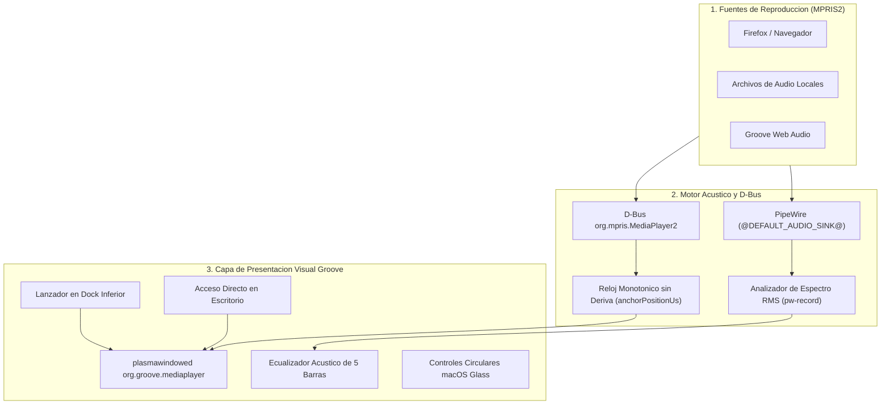

# Arquitectura del Preset de Optimizacion e Integracion del Sistema Linux Groove OS 0.4.2

## 1. Resumen de Componentes y Preset Integrado

Linux Groove OS 0.4.2 integra una arquitectura de aceleracion en tres capas:
1. **Capa del Kernel y Preload en Rust (`libgroove_fast.so`):** Inyeccion via `/etc/ld.so.preload` que clasifica en microsegundos los procesos graficos, eleva su prioridad de CPU (`nice -12` para compositores, `nice -8` para interfaces graficas) y optimiza las asignaciones de memoria a traves de buffers alineados.
2. **Daemon de Precarga en RAM (`groove-boostd.service`):** Daemon nativo en Rust que precarga en cache de memoria de acceso rapido mas de 400 bibliotecas criticas compartidas (Qt6, KDE Frameworks, Mesa DRI, PipeWire, Wayland), eliminando la latencia de acceso a disco.
3. **Preset Visual y Gestor de Perfiles (`groove-profile`):** Conmutador nativo en Rust capaz de modificar en tiempo real la latencia de KWin, la velocidad de animacion y los efectos graficos sin reiniciar la sesion.

---

## 2. Los Cuatro Perfiles de Optimizacion de Linux Groove

| Parametro | Perfil Expressive 3D (Por Defecto) | Perfil Instant (0 ms) | Perfil Studio (Audio Pro) | Perfil Stable |
| :--- | :--- | :--- | :--- | :--- |
| **AnimationSpeed** | `1` (Activo) | `0` (Desactivado) | `0` (Desactivado) | `1` (Estandar) |
| **AnimationDurationFactor** | `0.15` (80-150 ms reactivo) | `0.0` (Instantaneo) | `0.0` (Instantaneo) | `1.0` (1000 ms) |
| **Wobbly Windows (Gelatina)** | Activo (`Stiffness=15`, `Drag=85`) | Inactivo | Inactivo | Inactivo |
| **Cubo 3D de Escritorios** | Activo | Inactivo | Inactivo | Inactivo |
| **Desenfoque Cristal (Blur)** | Activo (`Strength=3`) | Inactivo | Inactivo | Inactivo |
| **Direct Scanout** | Activo (`true`) | Activo (`true`) | Activo (`true`) | Inactivo (`false`) |
| **LatencyPolicy** | `Low` | `ExtremelyLow` | `ExtremelyLow` | `Normal` |
| **PipeWire Quantum / Rate** | `1024` / 48000 Hz | `1024` / 48000 Hz | `256` / 48000 Hz (Ultra baja latencia) | `1024` / 48000 Hz |

El sistema arranca de manera predeterminada en el perfil **Expressive 3D**, combinando la aceleracion de precarga en RAM con fisicas elasticas de gelatina en las ventanas, cubo virtual 3D y desenfoque acelerado.

---

## 3. Arquitectura del Reproductor Multimedia Groove (`org.groove.mediaplayer`)

El reproductor multimedia propio de Groove esta disenado como un plasmoide reactivo desacoplado en tres capas:

### Integracion en el Sistema
- **Lanzador de Escritorio:** `/usr/share/applications/org.groove.mediaplayer.desktop`
- **Icono en el Dock Inferior:** Definido en `org.kde.plasma.desktop-layout.js` como lanzador predeterminado junto a Dolphin, Konsole, Firefox y Discover.
- **Acceso Directo:** `/home/groove/Desktop/Groove_Player.desktop`.
- **Ejecucion Standalone:** Comando `plasmawindowed org.groove.mediaplayer`, que abre el reproductor en su propia ventana con decoraciones semaforo estilo macOS a la izquierda.

---

## 4. Pantallas de Bienvenida (Splash Screens) y Shaders Preservados

Todos los archivos de animacion de arranque estan completamente integrados en `/usr/share/plasma/look-and-feel/`:

1. **`org.groove.labyrinth.desktop` (Splash Oficial por Defecto):**
   - Shader GLSL acelerado por Vulkan: `shaders/labyrinth.frag` y binario compilado `shaders/labyrinth.frag.qsb`.
   - Efecto visual: Laberinto cibernetico generado procedimentalmente mediante raymarching isometrico, con ondas de teclas de piano y logotipo retroiluminado en ambar y azul neon.
2. **`org.groove.ribbons.desktop`:**
   - Shader GLSL: `shaders/ribbons.frag` y `shaders/ribbons.frag.qsb`.
   - Efecto visual: Cintas fluidas sinusoidales reactivas.
3. **`org.groove.desktop`:**
   - Splash clasico con isotipo Groove y animacion de ondas acusticas suaves.

La restauracion de `AnimationSpeed=1` y `AnimationDurationFactor=0.15` permite que KSplashQML reproduzca las animaciones de manera fluida sin recortarlas.

---

## 5. Optimizaciones de Rendimiento y Supresion de Sobrecarga

1. **Eliminacion de PackageKit (`packagekit-qt6`):**
   - Se removio `packagekit-qt6` del sistema base para evitar que `packagekitd` indexe continuamente la base de datos de Arch Linux ARM en memoria RAM.
   - Discover opera al 100% como tienda de **Flatpak (Flathub)** y complementos visuales de KDE Store sin mostrar el cartel naranja de advertencia.
   - Para paquetes nativos y AUR se preservan `pacman` y `yay v13.0.0`.
2. **Desactivacion de Baloo (`baloofilerc`):**
   - Se fija `Indexing-Enabled=false` en `/etc/xdg/baloofilerc` y perfiles de usuario. Esto evita el consumo de mas de 250 MB de RAM y elimina ciclos de E/S innecesarios sobre el sistema OverlayFS en memoria.
3. **Prevencion del Oscurecimiento de Pantalla (`powerdevilrc` y `kwinrc`):**
   - Se configuran `DimDisplayWhenIdle=false`, `DimDisplayIdleTimeoutSec=0` y `TurnOffDisplayIdleTimeoutSec=0` en `/etc/xdg/powerdevilrc`.
   - Se desactiva la transicion automatica de Luz Nocturna con `[NightColor] Active=false` en `kwinrc`, garantizando brillo y calibracion constante sin atenuacion.

