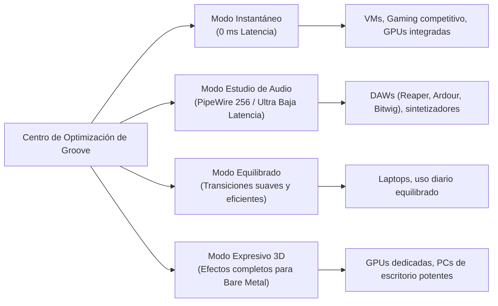
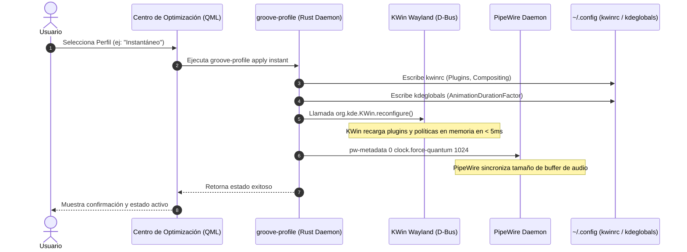

# Arquitectura de Optimización Gráfica y Centro de Rendimiento para Linux Groove

## 1. Visión General y Objetivos

Linux Groove está diseñado para ejecutarse tanto en entornos virtualizados ligeros (**QEMU / UTM / KVM**) como en hardware real (**Bare Metal**) con aceleración gráfica dedicada o integrada. 

En máquinas virtuales o equipos con recursos gráficos limitados, ciertos efectos visuales avanzados (como el desenfoque gaussiano de múltiples pasadas o la física de deformación de ventanas) pueden degradar severamente la fluidez de la interfaz. Para resolver esto de manera elegante y dar control total al usuario, se diseña el **Centro de Optimización de Groove** (*Groove Optimization Center*): una herramienta gráfica y de línea de comandos que permite conmutar en caliente entre distintos perfiles de rendimiento y ajustar parámetros críticos del compositor **KWin Wayland**, el servidor de audio **PipeWire** y la latencia del sistema.

---

## 2. Diagnóstico de Rendimiento: GPUs Virtuales (VirGL) vs Bare Metal

### 2.1 El Cuello de Botella en VirGL / ANGLE
En máquinas virtuales sobre hipervisores modernos como UTM en macOS, la aceleración gráfica 3D se realiza mediante **VirGL**:
- VirGL intercepta comandos de **OpenGL ES 3.0** dentro de la máquina virtual y los reenvía al host macOS, donde la capa **ANGLE** los traduce hacia **Metal**.
- Cada pasada de shader que requiere leer del búfer de pantalla anterior (como el desenfoque / *Blur* o las sombras difusas) obliga al host a sincronizar texturas intermedias entre la memoria virtual y la GPU real.

### 2.2 Comparativa de Parámetros Críticos

| Parámetro | Configuración Pesada (Lenta en VM) | Configuración Optimizada (*Instant*) | Impacto en Rendimiento |
| :--- | :--- | :--- | :--- |
| **`blurEnabled`** | `true` (desenfoque gaussiano) | `false` | Elimina la sincronización continua de texturas multi-pasada en VirGL. |
| **`wobblywindowsEnabled`** | `true` (`Stiffness=15, Friction=90`) | `false` | Elimina el cálculo continuo de física de deformación elástica de ventanas en CPU/GPU. |
| **`AnimationDurationFactor`** | `1.0` (o `0.25`) | `0` (0 ms / instantáneo) | Desactiva las transiciones de apertura/cierre de menús y ventanas; respuesta inmediata. |
| **`DirectScanout`** | `false` (copia intermedia de buffer) | `true` | El compositor vuelca directamente los búfers a la salida de pantalla de Wayland. |
| **`LatencyPolicy`** | `Normal` / `High` | `ExtremelyLow` | Reduce al mínimo el tiempo de espera entre eventos de entrada (ratón/teclado) y renderizado. |

---

## 3. Matriz de Perfiles de Optimización

El sistema define **4 perfiles preestablecidos**, accesibles tanto por terminal como por interfaz gráfica:



### Especificaciones Técnicas por Perfil

```json
{
  "profiles": {
    "instant": {
      "name": "Instantáneo",
      "description": "Máxima respuesta visual y fluidez extrema. Ideal para máquinas virtuales y hardware modesto.",
      "animation_duration_factor": 0.0,
      "latency_policy": "ExtremelyLow",
      "direct_scanout": true,
      "blur": false,
      "wobbly": false,
      "cube": false,
      "pipewire_quantum": 1024,
      "pipewire_rate": 48000
    },
    "studio": {
      "name": "Estudio de Audio",
      "description": "Optimizado para producción musical y DAWs con latencia de audio en tiempo real.",
      "animation_duration_factor": 0.0,
      "latency_policy": "ExtremelyLow",
      "direct_scanout": true,
      "blur": false,
      "wobbly": false,
      "cube": false,
      "pipewire_quantum": 256,
      "pipewire_rate": 48000
    },
    "balanced": {
      "name": "Equilibrado",
      "description": "Transiciones fluidas sutiles con bajo impacto de recursos.",
      "animation_duration_factor": 0.15,
      "latency_policy": "Low",
      "direct_scanout": true,
      "blur": false,
      "wobbly": false,
      "cube": false,
      "pipewire_quantum": 1024,
      "pipewire_rate": 48000
    },
    "expressive": {
      "name": "Expresivo 3D",
      "description": "Efectos visuales completos (Cubo 3D, Wobbly Windows, Blur). Recomendado solo en Bare Metal.",
      "animation_duration_factor": 0.3,
      "latency_policy": "Low",
      "direct_scanout": true,
      "blur": true,
      "wobbly": true,
      "cube": true,
      "pipewire_quantum": 1024,
      "pipewire_rate": 48000
    }
  }
}
```

---

## 4. Arquitectura de Conmutación en Caliente

La conmutación de perfiles no requiere reiniciar la sesión de usuario ni el servidor gráfico `kwin_wayland`. Se ejecuta de forma atómica a través de D-Bus:



---

## 5. Implementación del Backend en Rust (`groove-profile`)

El binario en Rust [`groove-profile`](file:///Volumes/HDEXTERNO/linux_groove/crates/groove-cli/src/bin/groove_profile.rs) gestiona la persistencia de configuración y las notificaciones a los subsistemas:

```rust
// Fragmento de la arquitectura en crates/groove-cli/src/bin/groove_profile.rs
use std::fs;
use std::path::PathBuf;
use std::process::Command;

pub struct ProfileSpecs {
    pub name: String,
    pub animation_duration_factor: String,
    pub latency_policy: String,
    pub direct_scanout: bool,
    pub blur: bool,
    pub wobbly: bool,
    pub cube: bool,
    pub quantum: u32,
    pub rate: u32,
}

pub fn apply_kwin_specs(specs: &ProfileSpecs) {
    let config_dir = dirs_or_home();
    let kwinrc_path = config_dir.join("kwinrc");
    let kdeglobals_path = config_dir.join("kdeglobals");

    // 1. Actualizar duración de animaciones en kdeglobals
    let kde_orig = fs::read_to_string(&kdeglobals_path).unwrap_or_default();
    let kde_patched = patch_ini_content(
        &kde_orig,
        &[("KDE", "AnimationDurationFactor", &specs.animation_duration_factor)],
    );
    let _ = fs::write(&kdeglobals_path, kde_patched);

    // 2. Actualizar plugins y compositor en kwinrc
    let kwin_orig = fs::read_to_string(&kwinrc_path).unwrap_or_default();
    let updates = [
        ("Compositing", "LatencyPolicy", specs.latency_policy.as_str()),
        ("Compositing", "DirectScanout", if specs.direct_scanout { "true" } else { "false" }),
        ("Plugins", "blurEnabled", if specs.blur { "true" } else { "false" }),
        ("Plugins", "wobblywindowsEnabled", if specs.wobbly { "true" } else { "false" }),
        ("Plugins", "cubeEnabled", if specs.cube { "true" } else { "false" }),
    ];
    let kwin_patched = patch_ini_content(&kwin_orig, &updates);
    let _ = fs::write(&kwinrc_path, kwin_patched);

    // 3. Notificar en caliente a KWin Wayland por D-Bus (sin reiniciar sesión)
    let _ = Command::new("qdbus6")
        .args([
            "org.kde.KWin",
            "/KWin",
            "org.kde.KWin.reconfigure",
        ])
        .output();

    // 4. Configurar el quantum de audio en PipeWire
    let _ = Command::new("pw-metadata")
        .args([
            "-n", "settings",
            "0",
            "clock.force-quantum",
            &specs.quantum.to_string(),
        ])
        .output();
}
```

---

## 6. Diseño e Implementación de la Ventana GUI: "Centro de Optimización de Groove"

Para ofrecer una experiencia nativa dentro de KDE Plasma 6, la ventana se implementa en **QML / Kirigami** (la tecnología oficial de interfaces de Plasma), permitiendo su ejecución independiente o integrada al Centro de Control de Groove.

### 6.1 Interfaz QML (`GrooveOptimizerWindow.qml`)

```qml
import QtQuick 2.15
import QtQuick.Controls 2.15
import QtQuick.Layouts 1.15
import org.kde.kirigami 2.20 as Kirigami

Kirigami.ApplicationWindow {
    id: root
    title: "Centro de Optimización — Linux Groove"
    minimumWidth: 580
    minimumHeight: 620

    pageStack.initialPage: Kirigami.Page {
        title: "Perfiles de Rendimiento y Gráficos"

        ColumnLayout {
            anchors.fill: parent
            anchors.margins: Kirigami.Units.largeSpacing
            spacing: Kirigami.Units.largeSpacing

            // Encabezado
            Kirigami.Heading {
                text: "Optimización del Entorno Gráfico"
                level: 2
            }
            Label {
                text: "Selecciona el perfil adecuado según tu hardware actual (Máquina Virtual o Bare Metal)."
                wrapMode: Text.WordWrap
                Layout.fillWidth: true
                opacity: 0.8
            }

            // Selector de Perfiles (Tarjetas interactivas)
            GridLayout {
                columns: 2
                Layout.fillWidth: true
                rowSpacing: Kirigami.Units.mediumSpacing
                columnSpacing: Kirigami.Units.mediumSpacing

                // Perfil 1: Instantáneo
                ProfileCard {
                    title: "Instantáneo (0 ms)"
                    subtitle: "Máxima fluidez. Sin retraso ni efectos pesados."
                    badge: "Recomendado para VM"
                    iconName: "speedometer"
                    accentColor: "#27AE60"
                    onActivated: applyProfile("instant")
                }

                // Perfil 2: Estudio de Audio
                ProfileCard {
                    title: "Estudio de Producción"
                    subtitle: "PipeWire en 256 quantum para mínima latencia de audio."
                    badge: "Baja Latencia"
                    iconName: "audio-card"
                    accentColor: "#2980B9"
                    onActivated: applyProfile("studio")
                }

                // Perfil 3: Equilibrado
                ProfileCard {
                    title: "Equilibrado"
                    subtitle: "Micro-animaciones suaves y consumo eficiente."
                    badge: "Estándar"
                    iconName: "battery-charging"
                    accentColor: "#F39C12"
                    onActivated: applyProfile("balanced")
                }

                // Perfil 4: Expresivo 3D
                ProfileCard {
                    title: "Expresivo 3D"
                    subtitle: "Ventanas elásticas, desenfoque y cubo 3D."
                    badge: "Solo Bare Metal"
                    iconName: "video-display"
                    accentColor: "#8E44AD"
                    onActivated: applyProfile("expressive")
                }
            }

            Kirigami.Separator { Layout.fillWidth: true }

            // Ajustes Individuales Avanzados
            Kirigami.Heading {
                text: "Ajustes Manuales Avanzados"
                level: 3
            }

            RowLayout {
                Layout.fillWidth: true
                Label { text: "Efecto de Ventanas Gelatinosas (Wobbly):"; Layout.fillWidth: true }
                Switch {
                    id: wobblySwitch
                    onToggled: toggleFeature("wobbly", checked)
                }
            }

            RowLayout {
                Layout.fillWidth: true
                Label { text: "Desenfoque de Ventanas y Paneles (Blur):"; Layout.fillWidth: true }
                Switch {
                    id: blurSwitch
                    onToggled: toggleFeature("blur", checked)
                }
            }

            RowLayout {
                Layout.fillWidth: true
                Label { text: "Volcado Directo de Pantalla (Direct Scanout):"; Layout.fillWidth: true }
                Switch {
                    id: directScanoutSwitch
                    checked: true
                    onToggled: toggleFeature("direct_scanout", checked)
                }
            }

            Item { Layout.fillHeight: true } // Espaciador
        }
    }

    function applyProfile(profileName) {
        // Invoca el backend nativo de Groove mediante proceso desacoplado
        // groove-profile <profileName>
    }
}
```

---

## 7. Acceso y Lanzador en el Sistema

Para que el usuario pueda abrir el **Centro de Optimización** con un solo clic desde el menú de inicio o la configuración:

### Archivo de Entrada de Escritorio:
`/usr/share/applications/groove-optimizer.desktop`:

```ini
[Desktop Entry]
Name=Centro de Optimización de Groove
Name[es]=Centro de Optimización de Groove
GenericName=Rendimiento y Latencia Gráfica
Comment=Configura perfiles de latencia, animaciones y aceleración gráfica
Exec=groove-optimizer
Icon=speedometer
Terminal=false
Type=Application
Categories=Settings;System;HardwareSettings;
Keywords=optimización;latencia;efectos;rendimiento;kwin;pipewire;gpu;
```

---

## 8. Resumen de Beneficios para Linux Groove

1. **Flexibilidad Total:** El usuario no está forzado a un único comportamiento gráfico; puede elegir máxima respuesta (0 ms) en una máquina virtual o disfrutar de los efectos visuales 3D cuando instale Groove en su máquina física.
2. **Conmutación Instantánea sin Reiniciar:** Todos los cambios se inyectan en caliente a KWin Wayland y PipeWire a través del bus de sesión D-Bus.
3. **Persistencia Garantizada:** Cada cambio se almacena en los archivos estándar `~/.config/kwinrc` y `~/.config/kdeglobals`, manteniéndose intacto tras apagar o reiniciar el equipo.

