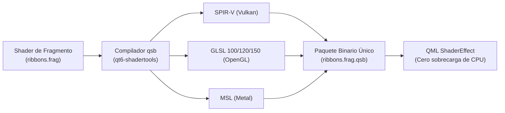

# Guía y Arquitectura Técnica: Shaders GLSL de Fragmentos y `qsb` en Linux Groove

**Documento:** `GROOVE_QML_GLSL_SHADERS_AND_QSB_GUIDE.md`  
**Estado:** Guía de Implementación y Arquitectura  
**Tecnología:** Qt 6.12 RHI, Vulkan GLSL 450, `qsb` (Qt Shader Baker), ShaderToy  
**Fecha:** Noviembre 2026  
**Autor:** Antigravity & Equipo de Ingeniería de Linux Groove  

---

## 1. Motivación Técnica: CPU Canvas 2D vs. GPU Shaders

En el desarrollo de interfaces y pantallas de bienvenida de alto rendimiento, la diferencia entre utilizar un lienzo tradicional `Canvas` y un sombreador de fragmentos (`ShaderEffect`) es fundamental:

| Criterio | QML `Canvas` (Contexto 2D) | QML `ShaderEffect` (GLSL en GPU) |
| :--- | :--- | :--- |
| **Lugar de Ejecución** | Hilo principal de la CPU (Rasterizador de software). | Miles de núcleos de sombreado en paralelo de la GPU. |
| **Cálculo de Curvas y Desenfoque** | Secuencial: cada trazo Bézier y cada pase de `shadowBlur` satura la CPU. | Masivo: cada píxel calcula su distancia y luz al mismo tiempo en hardware. |
| **Consumo de CPU** | **80% - 100%** (provoca congelamiento o tirones en VMs y laptops). | **< 1%** (el procesador queda completamente libre). |
| **Tasa de Refresco** | Inestable (15 - 30 FPS con caídas a 0 FPS). | **60 FPS fijos** sincronizados con V-Sync. |
| **Calidad Visual** | Líneas vectoriales planas y rígidas estilo dibujo 2D. | Niebla volumétrica, rayos luminosos, bloom orgánico y auroras. |

---

## 2. La Arquitectura de Shaders en Qt 6: RHI y `qsb`

En Qt 5, los shaders se escribían directamente como texto plano de OpenGL en el código QML. En **Qt 6**, se introdujo la arquitectura **RHI (Rendering Hardware Interface)**, que permite a Qt Quick funcionar de forma nativa e indistinta sobre:
* **Vulkan** (Estándar en Linux / Wayland moderno)
* **OpenGL / EGL** (Compatibilidad heredada y GPUs virtuales como VirGL)
* **Metal** (macOS)
* **Direct3D 11 / 12** (Windows)

Para que un único shader funcione en todas estas tecnologías sin retrabajo, Qt utiliza **`qsb` (Qt Shader Baker)**, una herramienta que compila código **Vulkan-style GLSL 450** a un paquete binario empaquetado (`.qsb`) que contiene los bytecodes SPIR-V y el código fuente GLSL para cada backend.



---

## 3. Anatomía de un Shader para Qt 6 (`ShaderEffect`)

Un sombreador de fragmentos compatible con Qt 6 debe cumplir tres reglas sintácticas obligatorias:

1. **Declaración Vulkan `#version 440`**: Requiere definir las ubicaciones de entrada y salida (`layout(location = 0)`).
2. **Bloque Uniforme `buf` con `layout(std140, binding = 0)`**: Todas las variables enviadas desde QML (tiempo, resolución, matrices) deben agruparse en este bloque.
3. **Variables estándar de Qt**: `qt_Matrix` (matriz de proyección) y `qt_Opacity` (opacidad del elemento QML).

### Estructura Base:

```glsl
#version 440

// Coordenadas UV normalizadas [0.0 a 1.0] que entrega QtQuick
layout(location = 0) in vec2 qt_TexCoord0;

// Color final RGBA que se dibuja en la pantalla
layout(location = 0) out vec4 fragColor;

// Bloque de datos uniformes sincronizados desde QML
layout(std140, binding = 0) uniform buf {
    mat4 qt_Matrix;
    float qt_Opacity;
    float uTime;         // Tiempo en segundos
    vec2 uResolution;    // Ancho y alto de la ventana
};

void main() {
    // Coordenadas centradas y normalizadas con corrección de aspecto
    vec2 uv = (gl_FragCoord.xy - 0.5 * uResolution) / uResolution.y;

    // Aquí va la matemática de la luz procedural...
    vec3 col = vec3(0.0);

    fragColor = vec4(col, 1.0) * qt_Opacity;
}
```

---

## 4. Implementación Concreta: Listones de Neón que Esquivan el Logo

A continuación se detalla el código del sombreador `ribbons.frag`. Implementa tres características esenciales:
1. **Fondo negro absoluto (`#000000`):** La luz emerge directamente del vacío.
2. **Campo de distorsión y exclusión del logo:** Utiliza una función elíptica que repele y curva las ondas de luz para que esquiven el centro sin tocar el icono.
3. **Listones con microfilamentos y resplandor de neón (*Volumetric Glow*):** Mediante funciones de distancia inversa $I = \frac{k}{|y - f(x)|}$.

```glsl
#version 440

layout(location = 0) in vec2 qt_TexCoord0;
layout(location = 0) out vec4 fragColor;

layout(std140, binding = 0) uniform buf {
    mat4 qt_Matrix;
    float qt_Opacity;
    float uTime;
    vec2 uResolution;
};

void main() {
    // 1. Normalización de coordenadas con centro en (0, 0)
    vec2 uv = (gl_FragCoord.xy - 0.5 * uResolution) / uResolution.y;

    // 2. Zona de Exclusión Elíptica para el logotipo central
    // Si la luz intenta pasar por el centro, se atenúa suavemente a cero
    vec2 logoBox = uv * vec2(1.0, 1.35);
    float distToCenter = length(logoBox);
    float clearance = smoothstep(0.16, 0.36, distToCenter);

    // 3. Deformación orgánica del espacio (Campo de fuerza alrededor del logo)
    // Desvía los rayos de luz hacia arriba o abajo según su posición
    float push = (1.0 - smoothstep(0.15, 0.45, distToCenter)) * 0.18;
    float pushDir = sign(uv.y);
    uv.y += pushDir * push;

    vec3 finalColor = vec3(0.0);

    // -------------------------------------------------------------
    // LISTÓN 1: Ámbar / Fuego (Inferior - fluyendo hacia la derecha)
    // -------------------------------------------------------------
    for (float i = 0.0; i < 4.0; i += 1.0) {
        float freq = 3.2 + i * 0.4;
        float speed = uTime * (0.6 + i * 0.08);
        float waveY = sin(uv.x * freq + speed) * 0.12 - 0.26 - (i * 0.02);
        
        // Intensidad luminosa inversa a la distancia
        float d = abs(uv.y - waveY);
        float glow = 0.0045 / (d + 0.002);
        
        // Gradiente cálido de neón
        vec3 amberCol = mix(vec3(1.0, 0.45, 0.05), vec3(1.0, 0.85, 0.20), i / 3.0);
        finalColor += amberCol * glow * clearance;
    }

    // -------------------------------------------------------------
    // LISTÓN 2: Azul Eléctrico / Cian (Cruzado inferior - flotando)
    // -------------------------------------------------------------
    for (float j = 0.0; j < 4.0; j += 1.0) {
        float freq = 2.8 + j * 0.35;
        float speed = -uTime * (0.55 + j * 0.07);
        float waveY = cos(uv.x * freq + speed) * 0.14 - 0.28 - (j * 0.02);
        
        float d = abs(uv.y - waveY);
        float glow = 0.0045 / (d + 0.002);
        
        vec3 cyanCol = mix(vec3(0.0, 0.75, 1.0), vec3(0.1, 0.40, 1.0), j / 3.0);
        finalColor += cyanCol * glow * clearance;
    }

    // -------------------------------------------------------------
    // LISTÓN 3: Aurora Violeta / Magenta (Superior - vuela sobre el logo)
    // -------------------------------------------------------------
    for (float k = 0.0; k < 3.0; k += 1.0) {
        float freq = 3.0 + k * 0.5;
        float speed = uTime * (0.45 + k * 0.06);
        float waveY = sin(uv.x * freq + speed + 1.5) * 0.10 + 0.24 + (k * 0.025);
        
        float d = abs(uv.y - waveY);
        float glow = 0.0040 / (d + 0.002);
        
        vec3 violetCol = mix(vec3(0.85, 0.20, 1.0), vec3(0.50, 0.10, 1.0), k / 2.0);
        finalColor += violetCol * glow * clearance;
    }

    // Aplicar opacidad general de la ventana
    fragColor = vec4(finalColor, 1.0) * qt_Opacity;
}
```

---

## 5. El Proceso de Compilación con `qsb`

Para compilar el archivo `.frag` en un paquete binario multiplataforma, se ejecuta la herramienta instalada en el sistema:

```bash
/usr/lib/qt6/bin/qsb \
    --glsl "100 es,120,150" \
    --hlsl 50 \
    --msl 12 \
    -o /usr/share/plasma/look-and-feel/org.groove.ribbons.desktop/contents/splash/shaders/ribbons.frag.qsb \
    /usr/share/plasma/look-and-feel/org.groove.ribbons.desktop/contents/splash/shaders/ribbons.frag
```

### Opciones de compilación explicadas:
* `--glsl "100 es,120,150"`: Genera versiones GLSL para OpenGL ES 2/3 (Mesa, VirGL, Raspberry Pi) y OpenGL de escritorio.
* `--hlsl 50`: Soporte para Direct3D 11/12.
* `--msl 12`: Soporte para Metal (Apple Silicon).
* `-o <salida.qsb>`: Genera el archivo empaquetado binario final de ~2 a 3 KB.

---

## 6. Integración en `Splash.qml`

En el archivo QML, se sustituye todo el antiguo bloque de `Canvas` por el elemento acelerado por GPU:

```qml
import QtQuick
import org.kde.kirigami as Kirigami

Rectangle {
    id: root
    color: "#000000"

    // Temporizador suave continuo que alimenta al Shader
    property real screensaverTime: 0.0
    NumberAnimation on screensaverTime {
        from: 0.0; to: 10000.0
        duration: 10000000 // Marcha continua
        loops: Animation.Infinite
        running: true
    }

    // CAPA 1: Sombreador de fragmentos ejecutado directamente en GPU
    ShaderEffect {
        id: neonWavesShader
        anchors.fill: parent

        // Propiedades vinculadas al bloque 'uniform buf' del shader
        property real uTime: root.screensaverTime
        property vector2d uResolution: Qt.vector2d(width, height)

        fragmentShader: "shaders/ribbons.frag.qsb"
    }

    // CAPA 2: Logotipo central limpio sobre fondo negro
    Item {
        anchors.centerIn: parent
        width: Math.min(parent.width * 0.44, Kirigami.Units.gridUnit * 21)
        height: width * 0.66

        Image {
            anchors.fill: parent
            source: "images/groove-logo-glow.png"
            fillMode: Image.PreserveAspectFit
            smooth: true
        }
    }
}
```

---

## 7. Cómo Portar Efectos desde ShaderToy

Cualquier shader de **[ShaderToy.com](https://www.shadertoy.com/)** (por ejemplo: humo cósmico, auroras, ecualizadores de audio) se puede convertir siguiendo esta sencilla tabla de equivalencias:

| En ShaderToy | En Qt 6 (`qsb` GLSL 440) |
| :--- | :--- |
| `void mainImage(out vec4 fragColor, in vec2 fragCoord)` | `void main()` |
| `fragCoord` | `gl_FragCoord.xy` |
| `iResolution.xy` | `uResolution` |
| `iTime` | `uTime` |
| Variables globales flotantes | Se declaran dentro de `layout(std140, binding = 0) uniform buf { ... };` |

---

## 7. Caso Práctico Real: Pantalla "Groove Stroke" (180 Filamentos de Luz)

La animación **"Groove Stroke"** (`org.groove.ribbons.desktop`) es el ejemplo cumbre de shaders GLSL en Linux Groove. Implementa una estética estilo protector de pantalla orgánico de fibra óptica sobre fondo 100% negro.

### 7.1. Arquitectura en Tres Capas en QML

```qml
// CAPA 0: Base 100% negro puro
Rectangle {
    id: root
    width: 1280; height: 800
    color: "#000000"

    // CAPA 1: Hilos de luz generados en GPU por fragment shader
    ShaderEffect {
        id: ribbonsShader
        z: 1
        anchors.fill: parent
        property real uTime: root.screensaverTime
        property vector2d uResolution: Qt.vector2d(width, height)
        fragmentShader: "shaders/ribbons.frag.qsb"
    }

    // CAPA 2: Emblema SVG/PNG de teclas de piano, completamente en capa superior
    Item {
        id: logoCenter
        z: 10
        anchors.centerIn: parent
        Image {
            anchors.fill: parent
            source: "images/groove-logo-glow.png"
        }
    }
}
```

### 7.2. 60 Filamentos Finos por Listón (Efecto Fibra Óptica)

En vez de bandas gruesas y planas, se calculan ~60 filamentos delgados por listón mediante un bucle de acumulación de intensidad lumínica:

```glsl
for (int i = 0; i < 60; ++i) {
    float fi = float(i) / 59.0;
    float offset = (fi - 0.5) * ribbonWidth1;
    
    // Variación armónica que trenza cada hilo independientemente
    float phase = fi * 15.70;
    float wobble = sin(uv.x * (3.6 + fi * 1.8) + phase + t1 * 1.1) * (0.016 * (1.0 - abs(fi - 0.5) * 0.5));
    
    float strandY = baseWave1 + offset + wobble;
    float d = abs(uv.y - strandY);
    
    // Núcleo ultrafino de 0.0011 más halo bloom
    float core = max(0.0, 1.0 - d / 0.0011);
    float bloom = 0.00065 / (d + 0.0018);
    float intensity = core * 1.1 + bloom * 0.75;
    
    vec3 col = mix(vec3(1.0, 0.88, 0.32), vec3(1.0, 0.42, 0.05), fi);
    finalColor += col * (intensity * 0.11) * clearance;
}
```

### 7.3. Evasión del Logo sin Costuras ($C^\infty$ Continuity)

**Problema:** Un condicional o función `sign(uv.y)` genera una discontinuidad abrupta en el ecuador $y = 0$, produciendo una costura o corte horizontal visible.

**Solución Matemática:** Se utiliza un campo de evasión gaussiano continuo dependiente de $x$:
$$\text{dodgeX} = \exp(-x^2 \cdot 10.0)$$

Al acercarse a la posición horizontal del logotipo ($x \to 0$):
- El listón superior se desvía suavemente hacia arriba: $y_{\text{base}} + \text{dodgeX} \cdot 0.19$.
- Los listones inferiores se desvían suavemente hacia abajo: $y_{\text{base}} - \text{dodgeX} \cdot 0.18$.
- El logotipo está protegido además por una máscara elíptica de exclusión `clearance = smoothstep(0.18, 0.38, length(uv * vec2(1.0, 1.36)))`.

El resultado es un flujo libre de fricciones, 100% continuo, que fluye alrededor del emblema central como seda en el viento.

---

*Fin del documento técnico.*

