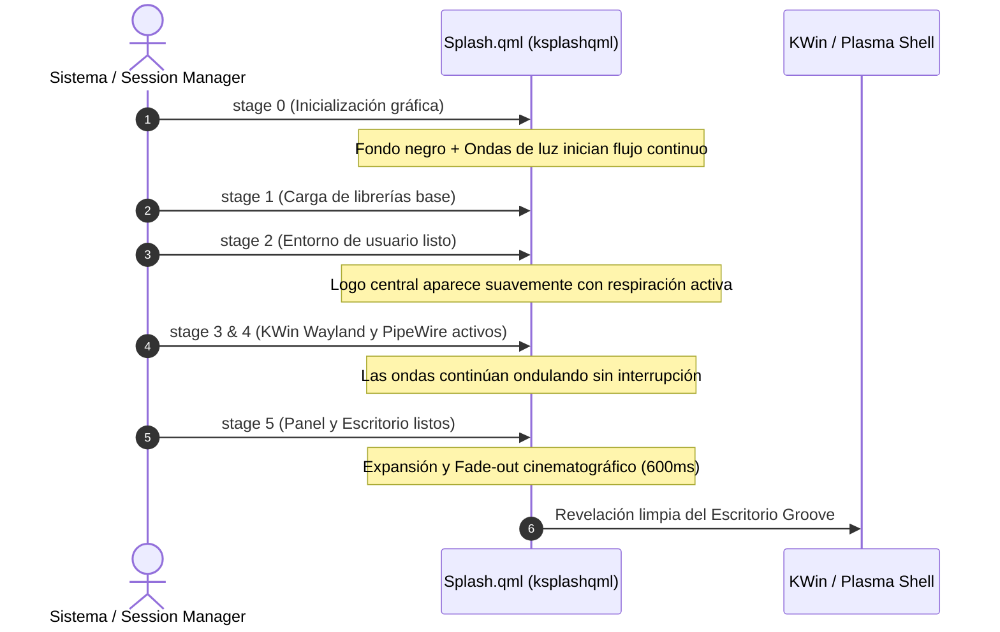

# Arquitectura y Diseño: Pantalla de Bienvenida (Splash Screen) de Linux Groove

**Documento:** `GROOVE_SPLASH_SCREEN_ARCHITECTURE.md`  
**Estado:** Especificación e Implementación Activa  
**Componente:** `org.groove.desktop` (`ksplashqml` / Plasma Look-and-Feel)  
**Fecha:** Noviembre 2026  
**Autor:** Antigravity & Equipo de Ingeniería de Linux Groove  

---

## 1. Visión General y Concepto de Diseño

La pantalla de bienvenida (*Splash Screen*) de **Linux Groove** sustituye la pantalla genérica de KDE ("Brisa") por una experiencia inmersiva de grado cinematográfico, diseñada bajo la identidad visual de la distribución:

1. **Fondo Negro Profundo (`#04060a`):** Conecta de forma continua y limpia desde el cargador de arranque (Plymouth / DRM framebuffer) sin saltos de brillo.
2. **Logotipo Central de Teclas / Onda Acústica (Groove Piano Equalizer):**
   * Iluminación dual icónica: resplandor ámbar/dorado cálido en el lateral izquierdo y azul eléctrico/neón en el lateral derecho.
   * Animación de respiración orgánica (*Breathing Pulse*): oscilación suave de escala (entre 98% y 102%) y resplandor ambiental.
3. **Siluetas de Ondas de Luz Ondulantes (*Ambient Screensaver Light Ribbons*):**
   * Listones de luz etéreos y sedosos que fluyen continuamente en segundo plano con gradientes aditivos en tonalidades naranja, azul cian y púrpura.
   * Renderizado vectorial matemático en GPU (sin peso de video ni demoras de decodificación).
4. **Transición Continua hacia el Escritorio:**
   * Al completarse la carga de los servicios (`stage 5`), la pantalla hace un fundido suave (*fade-out*) revelando el fondo de pantalla oficial de Groove, logrando una continuidad visual perfecta.

---

## 2. Ciclo de Vida y Estados en KDE Plasma 6 (`ksplashqml`)

El subsistema de inicio de KDE Plasma (`ksplashqml`) orquesta la pantalla de bienvenida mediante un protocolo de etapas (*stages*) comunicadas a través de D-Bus:



* **`stage == 0 / 1`:** Arranque ultra rápido; se inicializa la GPU y comienza la animación matemática de los listones de luz.
* **`stage == 2`:** El logo de teclas de Groove se ilumina progresivamente (`introAnimation: 0.0 -> 1.0`).
* **`stage == 3 y 4`:** Fase de espera activa; el logo respira y las siluetas de luz mantienen la pantalla viva mientras se cargan los componentes pesados de la sesión.
* **`stage == 5`:** Señal de fin de carga. Se desvanece la opacidad de la capa completa para entregar el control fluido al escritorio.

---

## 3. Estructura de Archivos del Paquete `org.groove.desktop`

El paquete Look-and-Feel de Groove se localiza en el árbol del sistema en:  
`/usr/share/plasma/look-and-feel/org.groove.desktop/`

```
org.groove.desktop/
├── metadata.json                                # Metadatos del tema y KPackageStructure
├── contents/
│   ├── defaults                                 # Configuración por defecto (Groove Dark, ksplashrc)
│   ├── layouts/
│   │   └── org.kde.plasma.desktop-layout.js     # Disposición de paneles y widgets
│   ├── previews/
│   │   └── splash.png                           # Miniatura visible en Preferencias del Sistema
│   └── splash/
│       ├── Splash.qml                           # Código fuente QML de la animación completa
│       └── images/
│           ├── groove-logo-glow.png             # Emblema central de teclas con transparencia limpia
│           └── light-ribbon.png                 # Textura opcional de soporte para partículas
```

---

## 4. Código Fuente Detallado de `Splash.qml`

El archivo `Splash.qml` combina un lienzo procedural `Canvas` de alto rendimiento para las ondas de luz, animaciones senoidales continuas y el emblema de teclas con resplandor pulsante:

```qml
/*
    Linux Groove - Ambient Frosted Wave Splash Screen
    SPDX-License-Identifier: GPL-2.0-or-later
*/

import QtQuick
import QtQuick.Effects as Effects
import org.kde.kirigami as Kirigami

Rectangle {
    id: root
    color: "#04060a" // Fondo negro profundo

    property int stage: 0

    // Sincronización con el ciclo de vida de carga de KDE
    onStageChanged: {
        if (stage === 1 || stage === 2) {
            fadeInAnimation.running = true;
        } else if (stage >= 5) {
            fadeOutAnimation.running = true;
        }
    }

    // Temporizador de fase de onda matemática para animación continua
    property real wavePhase: 0.0
    NumberAnimation on wavePhase {
        from: 0.0
        to: Math.PI * 2
        duration: 8000
        loops: Animation.Infinite
        running: true
    }

    // -------------------------------------------------------------
    // CAPA 1: Siluetas de ondas de luz ondulantes (Canvas Procedural)
    // -------------------------------------------------------------
    Canvas {
        id: waveCanvas
        anchors.fill: parent
        antialiasing: true

        onPaint: {
            var ctx = getContext("2d");
            ctx.clearRect(0, 0, width, height);

            var w = width;
            var h = height;
            var p = root.wavePhase;

            // Onda 1: Resplandor ámbar / dorado inferior
            var gradAmber = ctx.createLinearGradient(0, h * 0.4, w, h);
            gradAmber.addColorStop(0.0, "rgba(255, 120, 20, 0.0)");
            gradAmber.addColorStop(0.3, "rgba(255, 140, 30, 0.28)");
            gradAmber.addColorStop(0.7, "rgba(240, 80, 20, 0.15)");
            gradAmber.addColorStop(1.0, "rgba(255, 120, 20, 0.0)");

            ctx.beginPath();
            ctx.moveTo(0, h * 0.72 + Math.sin(p) * 25);
            ctx.bezierCurveTo(
                w * 0.35, h * 0.60 + Math.cos(p) * 45,
                w * 0.65, h * 0.85 + Math.sin(p * 1.2) * 35,
                w, h * 0.65 + Math.cos(p * 0.8) * 30
            );
            ctx.lineTo(w, h);
            ctx.lineTo(0, h);
            ctx.closePath();
            ctx.fillStyle = gradAmber;
            ctx.fill();

            // Onda 2: Listón de luz azul eléctrico / cian superior cruzado
            var gradBlue = ctx.createLinearGradient(0, 0, w, h * 0.7);
            gradBlue.addColorStop(0.0, "rgba(0, 160, 255, 0.0)");
            gradBlue.addColorStop(0.35, "rgba(0, 190, 255, 0.22)");
            gradBlue.addColorStop(0.65, "rgba(70, 80, 255, 0.18)");
            gradBlue.addColorStop(1.0, "rgba(0, 160, 255, 0.0)");

            ctx.beginPath();
            ctx.moveTo(0, h * 0.38 + Math.cos(p * 0.9) * 30);
            ctx.bezierCurveTo(
                w * 0.30, h * 0.52 + Math.sin(p * 1.1) * 40,
                w * 0.70, h * 0.28 + Math.cos(p) * 45,
                w, h * 0.48 + Math.sin(p * 0.7) * 35
            );
            ctx.bezierCurveTo(
                w * 0.65, h * 0.42 + Math.cos(p * 1.3) * 35,
                w * 0.35, h * 0.65 + Math.sin(p * 0.8) * 30,
                0, h * 0.55
            );
            ctx.closePath();
            ctx.fillStyle = gradBlue;
            ctx.fill();

            // Onda 3: Filamento fino de luz violeta / magenta etéreo
            var gradViolet = ctx.createLinearGradient(0, h * 0.5, w, h * 0.5);
            gradViolet.addColorStop(0.0, "rgba(180, 50, 255, 0.0)");
            gradViolet.addColorStop(0.5, "rgba(220, 80, 255, 0.35)");
            gradViolet.addColorStop(1.0, "rgba(180, 50, 255, 0.0)");

            ctx.beginPath();
            ctx.moveTo(0, h * 0.60 + Math.sin(p * 1.4) * 20);
            ctx.bezierCurveTo(
                w * 0.4, h * 0.45 + Math.cos(p * 1.2) * 30,
                w * 0.6, h * 0.70 + Math.sin(p * 0.9) * 25,
                w, h * 0.52 + Math.cos(p) * 20
            );
            ctx.lineWidth = 4;
            ctx.strokeStyle = gradViolet;
            ctx.stroke();
        }

        // Repintado continuo sincronizado con el cambio de fase
        Connections {
            target: root
            function onWavePhaseChanged() {
                waveCanvas.requestPaint();
            }
        }
    }

    // -------------------------------------------------------------
    // CAPA 2: Contenedor Central con Logo y Respiración de Brillo
    // -------------------------------------------------------------
    Item {
        id: logoContainer
        anchors.centerIn: parent
        width: Kirigami.Units.gridUnit * 18
        height: Kirigami.Units.gridUnit * 13
        opacity: 0.0

        // Resplandor ambiental trasero (Glow radial suave)
        Rectangle {
            anchors.centerIn: parent
            width: parent.width * 1.3
            height: parent.height * 1.3
            radius: width / 2
            opacity: 0.45
            gradient: Gradient {
                orientation: Gradient.Horizontal
                GradientStop { position: 0.0; color: "transparent" }
                GradientStop { position: 0.35; color: "#44ff8800" }
                GradientStop { position: 0.65; color: "#4400a2ff" }
                GradientStop { position: 1.0; color: "transparent" }
            }
        }

        // Logotipo Central de Teclas de Piano de Groove
        Image {
            id: pianoLogo
            anchors.centerIn: parent
            width: parent.width
            height: parent.height
            fillMode: Image.PreserveAspectFit
            asynchronous: true
            smooth: true
            source: "images/groove-logo-glow.png"

            // Animación de respiración orgánica (Breathing Pulse)
            SequentialAnimation on scale {
                loops: Animation.Infinite
                running: true
                NumberAnimation { from: 0.985; to: 1.02; duration: 2400; easing.type: Easing.InOutSine }
                NumberAnimation { from: 1.02; to: 0.985; duration: 2400; easing.type: Easing.InOutSine }
            }
        }
    }

    // -------------------------------------------------------------
    // CAPA 3: Animaciones de Entrada y Salida (Transición Cinematográfica)
    // -------------------------------------------------------------
    OpacityAnimator {
        id: fadeInAnimation
        target: logoContainer
        from: 0.0
        to: 1.0
        duration: 900
        easing.type: Easing.OutCubic
    }

    OpacityAnimator {
        id: fadeOutAnimation
        target: root
        from: 1.0
        to: 0.0
        duration: 650
        easing.type: Easing.InOutQuad
    }
}
```

---

## 5. Procedimiento de Integración y Prueba en Vivo

1. **Instalación de archivos:**
   * Guardar `Splash.qml` en `/usr/share/plasma/look-and-feel/org.groove.desktop/contents/splash/`.
   * Copiar el activo transparente del logo en `images/groove-logo-glow.png`.
   * Copiar la captura de vista previa en `contents/previews/splash.png`.
2. **Activación en la configuración:**
   * Establecer en `~/.config/ksplashrc`:
     ```ini
     [KSplash]
     Engine=KSplashQML
     Theme=org.groove.desktop
     ```
3. **Prueba en vivo sin reiniciar el equipo:**
   ```bash
   DISPLAY=:0 WAYLAND_DISPLAY=wayland-1 ksplashqml org.groove.desktop --test
   ```

---

*Fin del documento técnico.*
