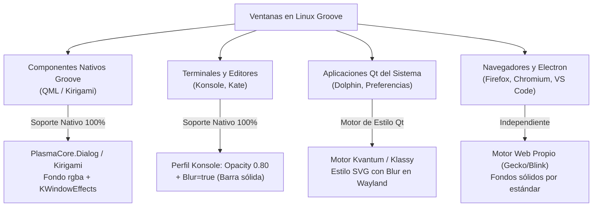

# Arquitectura y Hoja de Ruta: Estilo Acrílico / Vidrio Esmerilado (Frosted Glass) en Ventanas de Linux Groove

**Documento:** `GROOVE_WINDOW_TRANSLUCENCY_AND_ACRYLIC_ROADMAP.md`  
**Estado:** Propuesta Técnica / En Reserva para Implementación Futura  
**Fecha:** Noviembre 2026  
**Autor:** Antigravity & Equipo de Ingeniería de Linux Groove  

---

## 1. Visión General del Estilo Visual

El objetivo de diseño es dotar a las ventanas del entorno de escritorio de Linux Groove de una estética moderna tipo **Acrílico / Vidrio Esmerilado (*Frosted Glass*)**, tomando como referencia visual el **Menú de Inicio (Kickoff)** y los paneles del Shell de Plasma.

### Requisitos de Diseño
1. **Barra de título 100% Sólida y Opaca:** Mantener los botones de cerrar, minimizar y maximizar con total definición y contraste, sin transparencia en el marco de la ventana.
2. **Cuerpo de Ventana Translúcido con Desenfoque (*Blur-Behind*):** El fondo de la ventana debe dejar traslucir suavemente los colores y formas del fondo de pantalla mediante un desenfoque gaussiano suave.
3. **Contenido Foreground 100% Nítido:** Los textos, iconos, listas, carátulas y deslizadores deben mantener opacidad completa ($\alpha = 1.0$), evitando el efecto "ventana fantasma" o deslavada.

```
┌────────────────────────────────────────────────────────────────────────┐
│ 1. Marco y Barra de Título (kdecoration2 / Breeze)   ──► 100% SÓLIDO   │
├────────────────────────────────────────────────────────────────────────┤
│ 2. Fondo del Cuerpo (Canal Alfa: rgba(24, 28, 34, 0.75))               │
│    └─ Efecto Compositor KWin Blur ───────────────────► DESENFOCADO     │
│                                                                        │
│ 3. Textos, Botones, Deslizadores e Iconos ────────────► 100% NÍTITOS   │
└────────────────────────────────────────────────────────────────────────┘
```

---

## 2. Diagnóstico Técnico: Por qué la Opacidad Global de KWin Rules no es la Solución

Durante las pruebas iniciales con `kwinrulesrc` (`opacityactive=90`):
* **Falla de contraste en opacidades altas (90%):** En un fondo oscuro con ventanas oscuras, un cambio del 10% en el canal alfa general es prácticamente imperceptible a simple vista.
* **Falla de legibilidad en opacidades bajas (60% - 75%):** Las reglas de KWin operan sobre el búfer final renderizado de la ventana completa (*whole-window texture*). Al reducir la opacidad general, se vuelve transparente **todo**: la barra de título, el texto de las canciones y los controles, resultando en una ventana ilegible y de baja calidad visual.

### El Mecanismo Real del Menú Kickoff
Kickoff y los plasmoides de Plasma no usan opacidad global. Utilizan la siguiente pila técnica:
1. El widget define un fondo con canal alfa (e.g., `rgba(20, 24, 30, 0.8)` o un elemento SVG con textura translúcida).
2. La aplicación registra una región ante KWin vía el protocolo Wayland `org_kde_kwin_blur` (o la propiedad X11 `_KDE_NET_WM_BLUR_BEHIND_REGION`).
3. El compositor KWin aplica el shader de desenfoque (*KWin Blur Effect*) exclusivamente detrás de los píxeles translúcidos.
4. Los elementos Qt/QML encima del fondo se pintan con $\alpha = 1.0$, garantizando nitidez total.

---

## 3. Estrategia por Capas de Software

Para llevar este efecto a las diferentes ventanas del sistema, se requiere una solución específica según la tecnología de cada aplicación:



---

### A. Componentes Propios de Groove (Reproductor Groove, Docks, OSDs)
* **Tecnología:** Qt 6, QML, Kirigami, PlasmaCore.
* **Alcance:** Control total (100%).
* **Implementación técnica:**
  En [`main.qml`](file:///usr/share/plasma/plasmoids/org.groove.mediaplayer/contents/ui/main.qml) y [`ExpandedRepresentation.qml`](file:///usr/share/plasma/plasmoids/org.groove.mediaplayer/contents/ui/ExpandedRepresentation.qml), en lugar de heredar un fondo de ventana sólido (`Kirigami.Theme.Window`), se utiliza un fondo acrílico:

```qml
// Ejemplo para Reproductor Groove con Acrílico y Barra Sólida
import QtQuick
import org.kde.kirigami as Kirigami
import org.kde.plasma.core as PlasmaCore

Item {
    id: rootContainer

    // Fondo translúcido acrílico (el texto y controles quedan intactos encima)
    Rectangle {
        anchors.fill: parent
        color: Kirigami.Theme.darkMode ? Qt.rgba(0.08, 0.09, 0.12, 0.78)
                                       : Qt.rgba(0.96, 0.96, 0.98, 0.82)
        z: -1
    }

    // El decorador de la ventana (Breeze) se mantiene sólido en KWin
}
```

---

### B. Terminal del Sistema (Konsole)
* **Tecnología:** Qt6 / Konsole Part.
* **Alcance:** Control total nativo sin dependencias externas.
* **Implementación técnica:**
  En el perfil de Konsole (`~/.local/share/konsole/Groove.profile` o `etc/skel`):

```ini
[Appearance]
ColorScheme=GrooveDark
# 100% de opacidad de texto, 75% en el color de fondo:
Background=24,28,34,190

[General]
Name=Groove
Parent=FALLBACK/

[InteractionOptions]
UnderlineLinksEnabled=true

[Window]
# Activa el shader KWin Blur detrás de la terminal:
Blur=true
```
* **Resultado:** La barra de título permanece sólida y gris oscura (`Breeze`), el texto de la consola es 100% blanco y legible, y el fondo tiene el efecto esmerilado idéntico a Kickoff.

---

### C. Aplicaciones Estándar de KDE (Dolphin, KWrite, Preferencias)
* **Tecnología:** Qt Widgets / KXmlGui.
* **Desafío técnico:** El motor de estilo por defecto de KDE (`breeze-style`) dibuja las áreas de cliente con fondos sólidos por razones de contraste y compatibilidad heredada de Qt.
* **Solución de la industria:**
  1. **Motor Kvantum (`extra/kvantum`):**
     * Disponible oficialmente en los repositorios de Arch Linux.
     * Permite cargar temas con soporte nativo de desenfoque (*blur-behind*) para todas las ventanas de Qt.
     * Las barras de título siguen siendo gestionadas por Breeze (`kdecoration2`), manteniéndose sólidas.
  2. **Motor Klassy (`klassy`):**
     * Fork avanzado y moderno de Breeze para Plasma 6 diseñado específicamente para dar control granular sobre opacidad de fondo, bordes y desenfoque sin perder la identidad visual de KDE.

---

## 4. Consideraciones de Rendimiento y Virtualización

> [!WARNING]
> El efecto de desenfoque (*Blur*) requiere ejecutar pases de renderizado por sombreador de fragmentos (*fragment shader*) en el compositor.

* **En Hardware Real (Bare Metal con Intel Iris, AMD Radeon o NVIDIA):** El costo de rendimiento es insignificante (<1% GPU), ofreciendo 60 FPS estables.
* **En Entornos Virtualizados (QEMU/UTM con VirGL / llvmpipe):** Como se documentó en [`GROOVE_OPTIMIZATION_PROFILES_ARCHITECTURE.md`](file:///Volumes/HDEXTERNO/linux_groove/docs/GROOVE_OPTIMIZATION_PROFILES_ARCHITECTURE.md), el efecto `blur` puede generar latencia en compositores virtualizados sin aceleración 3D nativa.
* **Recomendación de Integración:** Vincular el estilo Frosted Glass al perfil de rendimiento:
  * `groove-profile performance / ultra`: Acrílico con Blur activado.
  * `groove-profile instant / battery`: Fondo sólido o translúcido simple sin pase de desenfoque.

---

## 5. Hoja de Ruta para Implementación Futura (Roadmap)

| Fase | Tarea | Componentes Involucrados |
| :---: | :--- | :--- |
| **Fase 1** | **Efecto Acrílico en Reproductor Groove** | `org.groove.mediaplayer` (QML): reemplazar el fondo sólido por fondo con canal alfa y habilitar blur de fondo. Mantener barra de título Breeze sólida. |
| **Fase 2** | **Perfil Translúcido de Konsole** | Configurar `GrooveDark.profile` con `Opacity=0.78` y `Blur=true` en `/etc/skel` para que la terminal abra con vidrio esmerilado de serie. |
| **Fase 3** | **Evaluación de Kvantum / Klassy en Rootfs** | Empaquetar y evaluar el tema acrílico para Dolphin y Preferencias en una imagen de prueba del sistema. |
| **Fase 4** | **Interruptor en el Centro de Control de Groove** | Agregar un conmutador simple en la interfaz gráfica: *"Efecto Vidrio Esmerilado (Activar/Desactivar)"*, conectado con los perfiles de optimización. |

---

*Fin del documento técnico.*

