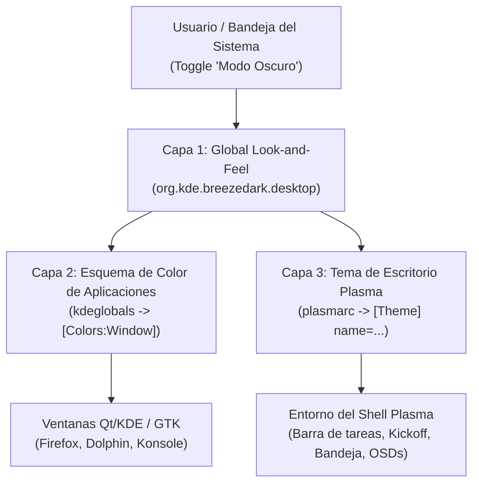

# Arquitectura de Temas en KDE Plasma 6: Diagnóstico y Solución de Sincronización de Modo Oscuro y Barra de Tareas

## 1. Resumen Ejecutivo del Problema

Al activar o desactivar el **Modo Oscuro** desde el widget del sistema (**Brillo y color** / Bandeja del sistema), se observaban dos síntomas críticos:
1. **Falta de sincronización visual:** Las ventanas de las aplicaciones (Firefox, Dolphin, Konsole) cambiaban a tonos oscuros, pero la **barra de tareas (panel)** y los popups de la bandeja del sistema permanecían en color **blanco / gris claro** (`#EFF0F1`).
2. **Aspecto alterado del panel tras cambios de iconos:** Al reiniciarse `plasmashell` tras instalar un icono o actualizar la caché, el panel adoptaba el tema claro por defecto en lugar del tema oscuro persistente.

---

## 2. Anatomía del Sistema de Temas en KDE Plasma 6

En KDE Plasma 6 (y Wayland en particular), la apariencia visual **no es monolítica**. Está dividida en 3 capas completamente independientes:



### Capa 1: Global Look-and-Feel Package (Tema Global)
- **Ruta de paquetes:** `/usr/share/plasma/look-and-feel/<package>/contents/defaults`
- **Función:** Define los paquetes maestros (`org.kde.breeze.desktop`, `org.kde.breezedark.desktop`, `org.groove.desktop`). Actúa como un puntero que indica qué esquema de color, iconos, decoraciones de ventana y tema de Plasma se deben activar de forma conjunta.

### Capa 2: Esquema de Color de Aplicaciones (Application Colors)
- **Archivo de configuración:** `~/.config/kdeglobals` (sección `[General] ColorScheme=` y `[Colors:*]`).
- **Herramienta:** `plasma-apply-colorscheme <SchemeName>`
- **Efecto:** Define la paleta de las ventanas y widgets de aplicaciones cliente (Dolphin, Konsole, System Settings, Firefox con tema de sistema).

### Capa 3: Tema de Escritorio de Plasma (Plasma Desktop Shell Theme)
- **Archivo de configuración:** `~/.config/plasmarc` (sección `[Theme] name=...`).
- **Ruta del sistema:** `/usr/share/plasma/desktoptheme/`
- **Herramienta:** `plasma-apply-desktoptheme <ThemeName>`
- **Efecto:** Controla **exclusivamente** el shell de Plasma: los SVGs, bordes, opacidad y colores de fondo del **Panel (barra de tareas), applets, menú de inicio (Kickoff) y ventanas emergentes (popups)**.

---

## 3. Diagnóstico Técnico de la Causa Raíz

### Causa Raíz 1: El bug upstream de KDE en `org.kde.breezedark.desktop/contents/defaults`
Al inspeccionar el paquete de tema oscuro oficial de KDE (`org.kde.breezedark.desktop`), se identificó la siguiente definición:

```ini
# /usr/share/plasma/look-and-feel/org.kde.breezedark.desktop/contents/defaults
[kdeglobals][KDE]
widgetStyle=Breeze

[kdeglobals][General]
ColorScheme=BreezeDark

[kdeglobals][Icons]
Theme=breeze-dark

[plasmarc][Theme]
name=default          <--- AQUÍ ESTÁ EL FALLO DE UPSTREAM
```

#### ¿Por qué `name=default` rompe la barra de tareas?
1. En KDE KConfig, cuando un valor en un paquete de defaults es `default`, la librería lo interpreta como *"revertir al valor por omisión de fábrica y borrar la clave del archivo de configuración del usuario"*. Como resultado, la clave `name=` es **eliminada** de `~/.config/plasmarc`.
2. Además, en `/usr/share/plasma/desktoptheme/default/` **NO existe un archivo `colors`**.
3. El tema `default` está catalogado internamente como `FollowsColorTheme` (tema adaptativo en tiempo de ejecución). Sin embargo, bajo Wayland, cuando `plasma-apply-lookandfeel` se ejecuta:
   - Intenta llamar a `xrdb` (el cual falla en Wayland con `Can't open display ''`).
   - `plasmashell` no recibe el evento de recarga del motor de estilos de SVG.
   - Al carecer de paleta explícita y no encontrar `[Theme] name=` en `plasmarc`, Plasma asume el fallback base: **Breeze Light (panel claro `#EFF0F1`)**.

### Causa Raíz 2: Falta de archivo de configuración de contingencia del sistema (`/etc/xdg/plasmarc`)
Cuando el archivo de configuración del usuario (`/home/groove/.config/plasmarc`) quedaba vacío tras una llamada de cambio de tema o tras un reinicio de sesión, Plasma busca el archivo de configuración global del sistema en `/etc/xdg/plasmarc`.
- **Estado previo:** `/etc/xdg/plasmarc` **no existía**.
- **Consecuencia:** Plasma no tenía a qué recurrir a nivel de sistema operativo y forzaba el tema claro por defecto.

### Causa Raíz 3: Comportamiento del Applet "Brillo y Color" (`DarkModeControl`)
El widget de la bandeja del sistema utiliza la clase C++ `DarkModeControl` (`powerdevil/applets/brightness/plugin/darkmodecontrol.cpp`).
Cuando el usuario presiona el interruptor de **Modo oscuro**:
```qml
// DarkModeItem.qml
PlasmaComponents3.Switch {
    id: darkModeSwitch
    text: i18nc("@action:button", "Dark Mode")
    checked: DarkModeControl.darkMode
    onClicked: DarkModeControl.darkMode = checked
}
```
En el backend C++:
```cpp
// Flujo interno de DarkModeControl
void DarkModeControl::setDarkMode(bool dark) {
    QString targetPackage = dark ? m_defaultDarkLookAndFeel : m_defaultLightLookAndFeel;
    // Ejecuta plasma-apply-lookandfeel -a targetPackage
    // m_defaultDarkLookAndFeel apunta a 'org.kde.breezedark.desktop'
}
```
Debido a que `org.kde.breezedark.desktop` tenía `[plasmarc][Theme] name=default`, el comando únicamente aplicaba la paleta a las ventanas (`kdeglobals`), pero borraba el tema de la barra de tareas en `plasmarc`.

---

## 4. Solución Implementada y Fragmentos de Código

Para corregir el fallo de forma definitiva tanto en la sesión en vivo como en la ISO y en nuevas cuentas de usuario, se implementaron cuatro cambios estructurales:

### 1. Corrección del paquete de tema oscuro oficial (`org.kde.breezedark.desktop`)
Se sobreescribió `/usr/share/plasma/look-and-feel/org.kde.breezedark.desktop/contents/defaults` para asignar explícitamente `breeze-dark`:

```ini
[kdeglobals][KDE]
widgetStyle=Breeze

[kdeglobals][General]
ColorScheme=BreezeDark

[kdeglobals][Icons]
Theme=breeze-dark

[plasmarc][Theme]
name=breeze-dark      # <--- CORREGIDO: Fuerza el panel oscuro explícito

[Wallpaper]
Image=Next
```

### 2. Configuración coherente para el modo claro (`org.kde.breeze.desktop`)
Se aseguró que al desactivar el modo oscuro, el panel cambie a `breeze-light` sin ambigüedad:

```ini
# /usr/share/plasma/look-and-feel/org.kde.breeze.desktop/contents/defaults
[kdeglobals][KDE]
widgetStyle=Breeze

[kdeglobals][General]
ColorScheme=BreezeLight

[kdeglobals][Icons]
Theme=breeze

[plasmarc][Theme]
name=breeze-light     # <--- Asigna el panel claro correspondiente

[Wallpaper]
Image=Next
```

### 3. Creación del fallback a nivel de sistema (`/etc/xdg/plasmarc`)
Se creó `/etc/xdg/plasmarc` para que cualquier usuario nuevo o cualquier reinicio mantenga el tema oscuro por defecto del sistema operativo:

```ini
# /etc/xdg/plasmarc
[Theme]
name=breeze-dark
```

Y en el esqueleto para nuevos usuarios (`/etc/skel/.config/plasmarc`):
```ini
# /etc/skel/.config/plasmarc
[Theme]
name=breeze-dark
```

### 4. Sincronización en vivo de la sesión actual
Se aplicaron los temas directamente en la sesión de Wayland del usuario `groove`:
```bash
sudo -u groove DBUS_SESSION_BUS_ADDRESS=unix:path=/run/user/1000/bus QT_QPA_PLATFORM=offscreen plasma-apply-desktoptheme breeze-dark
sudo -u groove DBUS_SESSION_BUS_ADDRESS=unix:path=/run/user/1000/bus QT_QPA_PLATFORM=offscreen plasma-apply-colorscheme BreezeDark
```

---

## 5. Tabla Comparativa de Comportamiento

| Componente | Antes de la Solución | Después de la Solución |
| :--- | :--- | :--- |
| **Ventanas de Aplicación (Dolphin, etc.)** | Se volvían oscuras | Se vuelven oscuras |
| **Barra de Tareas (Panel)** | Se quedaba blanca / gris claro (`#EFF0F1`) | **Oscura profunda (`#1E2022`)** |
| **Popups de la Bandeja (Brillo y color)** | Fondo blanco con texto claro ilegible | **Fondo oscuro con texto blanco nítido** |
| **Icono de Inicio de Groove** | Presente | **Presente y resaltado sobre fondo oscuro** |
| **Fallback ante borrado de config** | Caía al tema claro | **Protegido por `/etc/xdg/plasmarc` en oscuro** |

---

## 6. Persistencia e Integración en la ISO

Los archivos corregidos han sido integrados en los repositorios locales y en el contenedor de compilación de la imagen ISO:
- Repositorio git: [`scripts/arch/native/files/etc/xdg/plasmarc`](file:///Volumes/HDEXTERNO/linux_groove/scripts/arch/native/files/etc/xdg/plasmarc)
- Defaults de Look & Feel: [`scripts/arch/native/files/usr/share/plasma/look-and-feel/org.kde.breezedark.desktop/contents/defaults`](file:///Volumes/HDEXTERNO/linux_groove/scripts/arch/native/files/usr/share/plasma/look-and-feel/org.kde.breezedark.desktop/contents/defaults)
- Rootfs de la ISO: Sincronizado en `groove-graphical-build:/tmp/groove-native-root-0.4.1-rc1/`.
