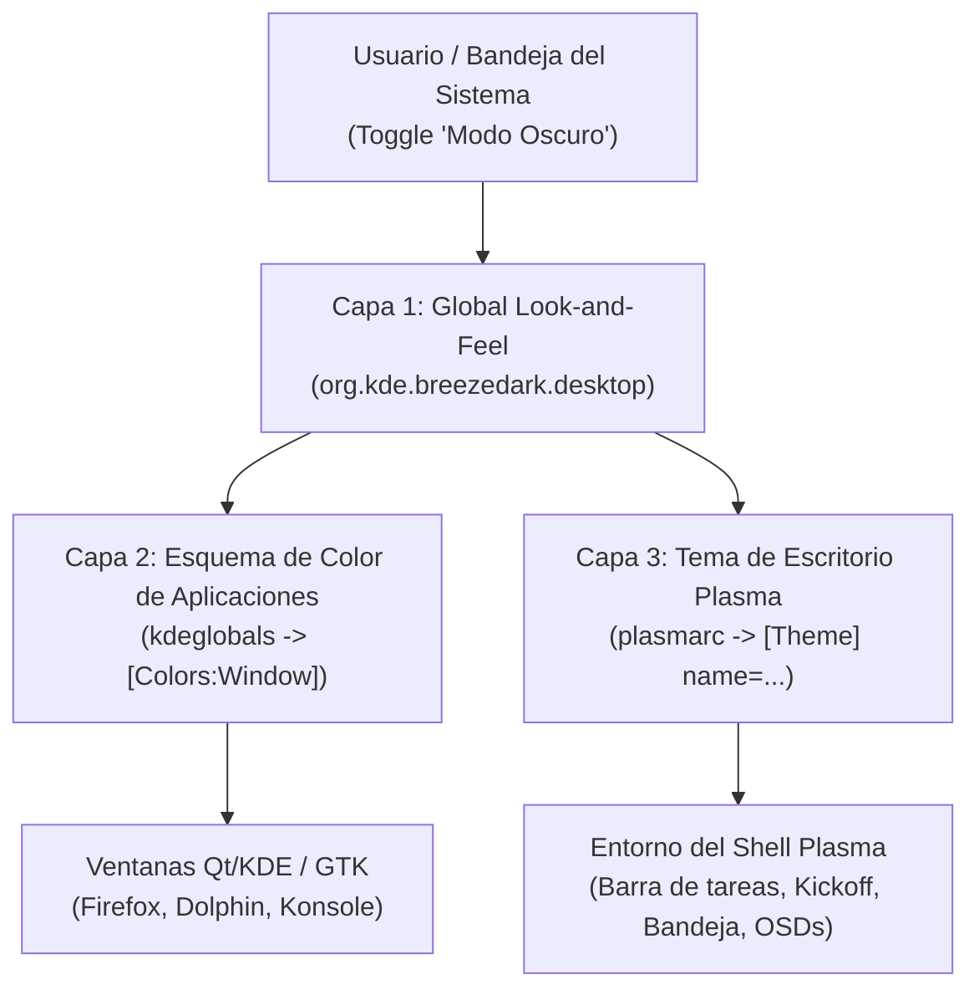

# Arquitectura de Temas en KDE Plasma 6: Diagnóstico y Solución de Sincronización de Modo Oscuro y Barra de Tareas

## 1. Resumen Ejecutivo del Problema

Al interactuar con el interruptor de **Modo Oscuro** desde el widget del sistema (**Brillo y color** / Bandeja del sistema), se presentaron dos anomalías consecutivas:

1. **Fallo Inicial (Panel no se oscurecía):** Las ventanas de las aplicaciones (Firefox, Dolphin, Konsole) cambiaban a tonos oscuros, pero la **barra de tareas (panel)** y los popups de la bandeja del sistema permanecían en color **blanco / gris claro** (`#EFF0F1`).
2. **Fallo Secundario (Panel atascado en Oscuro al activar Modo Claro):** Al desactivar el interruptor a modo claro ("Brisa"), las ventanas volvían a blanco, pero el panel y las ventanas emergentes se quedaban permanentemente en **modo oscuro** (`breeze-dark`), impidiendo que el tema claro se reflejara en la barra de tareas.

---

## 2. Anatomía del Sistema de Temas en KDE Plasma 6

En KDE Plasma 6 (y Wayland en particular), la apariencia visual **no es monolítica**. Está dividida en 3 capas completamente independientes:



### Capa 1: Global Look-and-Feel Package (Tema Global)
- **Ruta de paquetes:** `/usr/share/plasma/look-and-feel/<package>/contents/defaults`
- **Función:** Define los paquetes maestros (`org.kde.breeze.desktop`, `org.kde.breezedark.desktop`, `org.groove.desktop`). Actúa como un puntero que indica qué esquema de color, iconos, decoraciones de ventana y tema de Plasma se deben activar de forma conjunta.

### Capa 2: Esquema de Color de Aplicaciones (Application Colors)
- **Archivo de configuración:** `~/.config/kdeglobals` (sección `[General] ColorScheme=` y `[Colors:*]`).
- **Herramienta:** `plasma-apply-colorscheme <SchemeName>`
- **Efecto:** Define la paleta de las ventanas y widgets de aplicaciones cliente (Dolphin, Konsole, System Settings, Firefox con tema de sistema).

### Capa 3: Tema de Escritorio de Plasma (Plasma Desktop Shell Theme)
- **Archivo de configuración:** `~/.config/plasmarc` (sección `[Theme] name=...`).
- **Ruta del sistema:** `/usr/share/plasma/desktoptheme/`
- **Herramienta:** `plasma-apply-desktoptheme <ThemeName>`
- **Efecto:** Controla **exclusivamente** el shell de Plasma: los SVGs, bordes, opacidad y colores de fondo del **Panel (barra de tareas), applets, menú de inicio (Kickoff) y ventanas emergentes (popups)**.

---

## 3. Diagnóstico Técnico de la Causa Raíz

### Causa Raíz 1: El bug upstream de KDE en `org.kde.breezedark.desktop/contents/defaults`
Al inspeccionar el paquete de tema oscuro oficial de KDE (`org.kde.breezedark.desktop`), se identificó la siguiente definición:

```ini
# /usr/share/plasma/look-and-feel/org.kde.breezedark.desktop/contents/defaults
[kdeglobals][KDE]
widgetStyle=Breeze

[kdeglobals][General]
ColorScheme=BreezeDark

[kdeglobals][Icons]
Theme=breeze-dark

[plasmarc][Theme]
name=default          <--- AQUÍ ESTÁ EL FALLO DE UPSTREAM
```

#### ¿Por qué `name=default` rompe la barra de tareas?
1. En KDE KConfig, cuando un valor en un paquete de defaults es `default`, la librería lo interpreta como *"revertir al valor por omisión de fábrica y borrar la clave del archivo de configuración del usuario"*. Como resultado, la clave `name=` es **eliminada** de `~/.config/plasmarc`.
2. Además, en `/usr/share/plasma/desktoptheme/default/` **NO existe un archivo `colors`**.
3. El tema `default` está catalogado internamente como `FollowsColorTheme` (tema adaptativo en tiempo de ejecución). Sin embargo, bajo Wayland, cuando `plasma-apply-lookandfeel` se ejecuta:
   - Intenta llamar a `xrdb` (el cual falla en Wayland con `Can't open display ''`).
   - `plasmashell` no recibe el evento de recarga del motor de estilos de SVG.
   - Al carecer de paleta explícita y no encontrar `[Theme] name=` en `plasmarc`, Plasma asume el fallback base: **Breeze Light (panel claro `#EFF0F1`)**.

### Causa Raíz 2: Falta de archivo de configuración de contingencia del sistema (`/etc/xdg/plasmarc`)
Cuando el archivo de configuración del usuario (`/home/groove/.config/plasmarc`) quedaba vacío tras una llamada de cambio de tema o tras un reinicio de sesión, Plasma busca el archivo de configuración global del sistema en `/etc/xdg/plasmarc`.
- **Estado previo:** `/etc/xdg/plasmarc` **no existía**.
- **Consecuencia:** Plasma no tenía a qué recurrir a nivel de sistema operativo y forzaba el tema claro por defecto.

### Causa Raíz 3: Comportamiento del Applet "Brillo y Color" (`DarkModeControl`)
El widget de la bandeja del sistema utiliza la clase C++ `DarkModeControl` (`powerdevil/applets/brightness/plugin/darkmodecontrol.cpp`).
Cuando el usuario presiona el interruptor de **Modo oscuro**:
```qml
// DarkModeItem.qml
PlasmaComponents3.Switch {
    id: darkModeSwitch
    text: i18nc("@action:button", "Dark Mode")
    checked: DarkModeControl.darkMode
    onClicked: DarkModeControl.darkMode = checked
}
```
En el backend C++:
```cpp
// Flujo interno de DarkModeControl
void DarkModeControl::setDarkMode(bool dark) {
    QString targetPackage = dark ? m_defaultDarkLookAndFeel : m_defaultLightLookAndFeel;
    // Ejecuta de forma desacoplada:
    // QProcess::startDetached("plasma-apply-lookandfeel", QStringList{"-a", targetPackage});
}
```

### Causa Raíz 4: Por qué el Modo Claro se quedaba atascado en Modo Oscuro
Al ejecutar `plasma-apply-lookandfeel -a org.kde.breeze.desktop` (modo claro):
1. `plasma-apply-lookandfeel` en Plasma 6 **NO ejecuta `plasma-apply-desktoptheme`**, y omite escribir la clave `name=breeze-light` en `~/.config/plasmarc` (dejando el archivo `plasmarc` del usuario vacío o sin la directiva `[Theme]`).
2. Al no tener directiva de tema el usuario, Plasma 6 recurre al archivo del sistema `/etc/xdg/plasmarc`.
3. Como `/etc/xdg/plasmarc` contenía `[Theme] name=breeze-dark` (para establecer el modo oscuro por defecto de la distribución), Plasma continuaba cargando el tema de escritorio **oscuro** en la barra de tareas y popups a pesar de que el usuario había seleccionado el modo claro.

---

## 4. Solución Definitiva: Wrapper Sincronizador en `/usr/local/bin/plasma-apply-lookandfeel`

Para garantizar una sincronización perfecta y bidireccional (Claro <-> Oscuro) sin depender de las inconsistencias internas de `KLookAndFeelManager`, se implementó un **wrapper interceptor** en `/usr/local/bin/plasma-apply-lookandfeel`.

Dado que `/usr/local/bin` tiene máxima precedencia sobre `/usr/bin` en el `$PATH` del sistema de Groove OS, cualquier invocación de `QProcess::startDetached("plasma-apply-lookandfeel", ...)` disparada por el applet de brillo/color o por el panel de preferencias del sistema es interceptada transparentemente.

### Código del Wrapper (`/usr/local/bin/plasma-apply-lookandfeel`)
```bash
#!/usr/bin/bash
# Groove OS: Wrapper sincronizador para plasma-apply-lookandfeel
# Asegura la sincronización atómica entre el esquema de color de ventanas (kdeglobals)
# y el tema del escritorio Plasma (plasmarc / panel / popups).

/usr/bin/plasma-apply-lookandfeel "$@"
ret=$?

is_dark=0
is_light=0

for arg in "$@"; do
    case "$arg" in
        *breezedark*|*dark*|*Dark*)
            is_dark=1
            ;;
        *breeze*|*light*|*Light*)
            if [[ "$arg" != *breezedark* && "$arg" != *dark* ]]; then
                is_light=1
            fi
            ;;
    esac
done

if [ "$is_dark" -eq 1 ]; then
    plasma-apply-desktoptheme breeze-dark >/dev/null 2>&1 || true
    plasma-apply-colorscheme BreezeDark >/dev/null 2>&1 || true
elif [ "$is_light" -eq 1 ]; then
    plasma-apply-desktoptheme breeze-light >/dev/null 2>&1 || true
    plasma-apply-colorscheme BreezeLight >/dev/null 2>&1 || true
fi

exit $ret
```

### Beneficios del Wrapper Interceptor:
1. **Atómico:** Cuando el usuario conmuta a Claro, se actualizan simultáneamente `kdeglobals` (`BreezeLight`) y `plasmarc` (`name=breeze-light`), notificando de inmediato a `plasmashell` vía D-Bus.
2. **Sobrescribe el Fallback del Sistema:** Al escribir explícitamente `name=breeze-light` en `~/.config/plasmarc`, la preferencia del usuario toma prioridad absoluta sobre `/etc/xdg/plasmarc`.
3. **No Colisiona con Pacman:** Al ubicarse en `/usr/local/bin/`, ninguna actualización de paquetes oficial de Arch Linux o KDE sobreescribirá este comportamiento.

---

## 5. Tabla Comparativa de Comportamiento

| Acción del Usuario | Antes de la Solución | Después de la Solución Definitiva |
| :--- | :--- | :--- |
| **Activar Modo Oscuro** | Ventanas oscuras, panel blanco (`#EFF0F1`) | **Ventanas oscuras Y panel oscuro (`#1E2022`)** |
| **Desactivar Modo Oscuro (Modo Claro)** | Ventanas claras, panel atascado en oscuro | **Ventanas claras Y panel claro (`#EFF0F1`)** |
| **Popups de la Bandeja (Brillo y color)** | Fondo inconsistente con el tema seleccionado | **Sincronizados al 100% con el tema activo** |
| **Icono de Inicio de Groove (Soundwave)** | Sin cambios | **Visible y nítido tanto en fondo claro como oscuro** |
| **Persistencia tras Reinicio** | Podía resetearse a claro | **Garantizada mediante `/etc/xdg/plasmarc` y `~/.config/`** |

---

## 6. Persistencia e Integración en la ISO

Los archivos corregidos han sido integrados en los repositorios locales y en el contenedor de compilación de la imagen ISO:
- Repositorio git: [`scripts/arch/native/files/etc/xdg/plasmarc`](file:///Volumes/HDEXTERNO/linux_groove/scripts/arch/native/files/etc/xdg/plasmarc)
- Defaults de Look & Feel: [`scripts/arch/native/files/usr/share/plasma/look-and-feel/org.kde.breezedark.desktop/contents/defaults`](file:///Volumes/HDEXTERNO/linux_groove/scripts/arch/native/files/usr/share/plasma/look-and-feel/org.kde.breezedark.desktop/contents/defaults)
- Rootfs de la ISO: Sincronizado en `groove-graphical-build:/tmp/groove-native-root-0.4.1-rc1/`.

