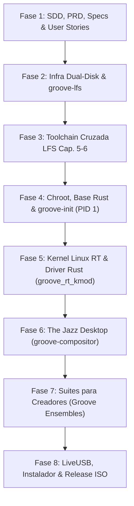

# Linux Groove OS: Plan Maestro y Fases de Implementación

## Entrega progresiva vigente — 2026-11-05

1. Base funcional existente: Weston/LightDM/XFCE sobre LFS y groove-init.
2. Blue Note Glass: Wayfire + Waybar, fondo piano, Mesa VirGL y efectos 3D;
   promover tras aceptación UTM. Mientras tanto, el inicio normal sigue en Weston.
3. Compositor propio Rust/Smithay con criterios de la spec 008.
4. Suites creativas y validación de audio RT.

Las cifras históricas de tamaño, RAM, arranque y audio son objetivos pendientes
de medición. La especificación vigente de esta etapa es la
[011](../specs/011-wayfire-blue-note-glass-spec.md).

*The Blue Note Edition — A Rustified LFS Linux Distribution for Artists and Creators*

---

## 1. Resumen Ejecutivo y Metas de Arquitectura

**Linux Groove OS** es una distribución de Linux construida artesanalmente desde cero siguiendo la guía oficial **Linux From Scratch (LFS 12.2)** y **BLFS**, implementando una estrategia de **Rustification** en todo el espacio de usuario (PID 1, coreutils, sudo, compositor gráfico, instalador y herramientas de sistema), junto a un **Kernel Linux 6.12 con soporte `PREEMPT_RT` y módulo de kernel escrito en Rust (`groove_rt_kmod`)**.

### Principios Fundamentales
1. **Bebop Efficiency (Ultraligera y Potente):**
   - Tamaño base LiveUSB: `< 800 MB`.
   - Consumo de memoria RAM en reposo (idle): `< 220 MB`.
   - Tiempo de arranque hasta el shell gráfico: `< 3 segundos`.
   - Latencia de audio RT: `< 2.5 ms` a 48kHz / 64 samples (cero xruns).
2. **Velvet & Brass UI (Estética Jazz Clásica):**
   - Compositor Wayland propio (`groove-compositor`) sobre Smithay + WGPU.
   - Paleta cromática: *Midnight Club* (`#0B0E17`), *Vinyl Groove* (`#141926`), *Warm Brass* (`#D4AF37`), *Bebop Coral* (`#E05A47`), *Cream Sleeve* (`#F4EFE6`).
   - Topbar analógica con vúmetro estéreo real/simulado, monitor de latencia DSP, dock flotante con transiciones fluidas.
3. **Groove Sessions (Estudio Modular para Creadores):**
   - Capas SquashFS independientes montadas en caliente con OverlayFS:
     - `ensemble-jazz-audio`: PipeWire RT, Jack2, Ardour, sintetizadores, metrónomo/afinador nativo.
     - `ensemble-visual-design`: Inkscape, GIMP, Krita, FontManager, selector de paletas.
     - `ensemble-cinema-video`: Kdenlive, OBS Studio, FFmpeg con aceleración VA-API.
     - `ensemble-darkroom-photo`: Darktable, RawTherapee, visor ultrarrápido EXIF en Rust.
     - `ensemble-rust-dev`: Rustc, Cargo, Helix preconfigurado con tema Blue Note, Alacritty.
4. **Infraestructura de Almacenamiento Híbrida (Doble Disco):**
   - `/Volumes/HDEXTERNO/linux_groove`: Código fuente, crates Rust, documentación SDD y manifiestos LFS.
   - `/Volumes/Backup/linux_groove_terabit`: ExFAT (509 GB libres) sin límite de 4 GB para la imagen virtual `lfs_root.ext4`, repositorios clonados de Rust (`uutils`, `sudo-rs`), caché `cargo-target` e imágenes `.iso` finales.

---

## Entrega progresiva vigente — 2026-11-04

Las ocho fases siguientes describen la visión original, no una certificación
de que todas estén completadas. El estado auditable está en el tracker.

1. Base gráfica: compilación BLFS, LightDM con selector, XFCE/X11, Weston,
   utilidades y Firefox; integración con groove-init y LiveUSB.
2. Escritorio propio: Smithay anidado, backend DRM/KMS, shell Blue Note y
   registro de «Groove Desktop» cuando ejecute aplicaciones reales.
3. Estudio creativo: servicios de audio reales, telemetría medida y suites
   verificadas. Las demostraciones actuales no acreditan esta etapa.

Ver [plan de implementación](../plans/GRAPHICAL_DESKTOP_IMPLEMENTATION.md),
[spec 007](../specs/007-graphical-sessions-spec.md) y
[spec 008](../specs/008-smithay-desktop-roadmap-spec.md).

## 2. Mapa Detallado de las 8 Fases del Proyecto

### Fase 1: Ingeniería SDD, PRD, Specs & Check de Avance
- **Objetivo:** Definir con rigor técnico todos los requisitos, interfaces de drivers, ciclo de vida del init, compositor gráfico, suites y criterios de aceptación.
- **Entregables:**
  - `docs/PRD.md` (Product Requirements Document).
  - `docs/specs/001-lfs-orchestrator-spec.md` (Especificación del motor LFS).
  - `docs/specs/002-kernel-and-drivers-spec.md` (Especificación de Kernel RT y Driver en Rust).
  - `docs/specs/003-rust-userspace-init-spec.md` (Especificación de `groove-init` PID 1).
  - `docs/specs/004-jazz-wayland-desktop-spec.md` (Especificación de `groove-compositor`).
  - `docs/specs/005-creator-studio-profiles-spec.md` (Especificación de Ensembles modulares).
  - `docs/specs/006-liveusb-iso-installer-spec.md` (Especificación del instalador y LiveUSB).
  - `docs/USER_STORIES.md` (Historias de usuario con sintaxis Gherkin).
  - `docs/PROGRESS_TRACKER.md` (Checklist de avance interactivo con más de 85 puntos).

### Fase 2: Infraestructura Dual-Disk & Motor `groove-lfs` en Rust
- **Equivalencia LFS:** Capítulos 1, 2, 3 y 4 (Preparación de host, imagen EXT4, descarga y FHS).
- **Entregables:**
  - Workspace Cargo multi-crate (`crates/groove-common`, `crates/groove-lfs`, etc.).
  - Configuración centralizada `groove-config.toml`.
  - Inicialización de directorios en `/Volumes/Backup/linux_groove_terabit`.
  - Creación de imagen sparse de 40 GB `lfs_root.ext4`.
  - Clonación/descarga de repositorios oficiales (`uutils/coreutils`, `sudo-rs`).
  - CLI `groove-lfs` con comandos de inspección, verificación de hashes SHA-256 y dashboard.

### Fase 3: Cross-Toolchain & Herramientas Temporales Rustificadas
- **Equivalencia LFS:** Capítulos 5 y 6 (Cross-binutils, GCC Pass 1 & 2, Glibc, Libstdc++, uutils cruzado).
- **Entregables:**
  - Manifiestos declarativos `lfs/chapters/chapter05_cross_toolchain.toml` y `chapter06_temp_tools_rust.toml`.
  - Contenedor Docker multi-arquitectura (`aarch64` / `x86_64`) con montajes loopback a `lfs_root.ext4`.
  - Compilación cruzada de la base C indispensable y de las utilidades temporales en Rust en `$LFS/tools`.

### Fase 4: Chroot, Sistema Base Rust & `groove-init` (PID 1)
- **Equivalencia LFS:** Capítulos 7, 8 y 9 (Entrada a Chroot, Sistema Final y Configuración).
- **Entregables:**
  - Crate `crates/groove-init`: PID 1 en Rust con supervisor de servicios, soporte para DAG de dependencias, zram swap y recolección limpia de huérfanos.
  - Integración de `uutils/coreutils` como herramientas estándar (`ls`, `cp`, `cat`, etc.).
  - Integración de `sudo-rs` y `starship` prompt.
  - Configuración del sistema (`/etc/fstab`, `/etc/groove/services/*.toml`, límites RT de audio PAM).

### Fase 5: Kernel Linux RT & Driver Development en Rust
- **Equivalencia LFS:** Capítulo 10 (Kernel Linux, módulos y driver development).
- **Entregables:**
  - Configuración del Kernel Linux 6.12 con parche `PREEMPT_RT` y `CONFIG_RUST=y`.
  - Driver en Rust `driver/groove_rt_kmod`:
    - Dispositivo `/dev/groove_rt`.
    - IOCTLs para elevación de prioridad SCHED_FIFO sin privilegios de root para apps de audio registradas.
    - Monitor de jitter y xruns en nanosegundos expuesto mediante sysfs.
  - Configuración de drivers para GPU (`virtio-gpu`, AMD, Intel) y Audio USB (`snd-usb-audio`).

### Fase 6: The Jazz Desktop (`groove-compositor` Wayland)
- **Equivalencia BLFS:** Ecosistema Gráfico (DRM/KMS, Mesa, Libinput, Wayland protocols, Smithay).
- **Entregables:**
  - Crate `crates/groove-compositor`: Servidor gráfico Wayland propio en Rust.
  - Interfaz *Blue Note*:
    - Topbar analógica con vúmetro de audio estéreo L/R en vivo.
    - Monitor de CPU y latencia DSP (`0.8 ms @ 48kHz`).
    - *The Brass Dock*: lanzador inferior con animaciones fluidas.
    - Modo híbrido de ventanas: *Bebop Tiling* y *Free Jazz Floating* conmutables con `Super + Space`.

### Fase 7: Entorno para Artistas y Creadores (`groove-session` y Ensembles)
- **Equivalencia BLFS:** Suites creativas y empaquetado modular.
- **Entregables:**
  - Crate `crates/groove-session`: Orquestador de perfiles de artistas.
  - Herramientas nativas en Rust:
    - `groove-tuner`: Afinador y metrónomo analógico de alta precisión.
    - `groove-palette`: Extractor y generador de armonías de color para diseñadores.
  - Imágenes SquashFS montables (`.ensemble`) para Audio, Diseño, Video, Fotografía y Desarrollo.

### Fase 8: Empaquetado LiveUSB, Instalador & Generación `.iso`
- **Equivalencia LFS:** Capítulo 11 y sistema de distribución.
- **Entregables:**
  - Initramfs en Rust (`groove-initramfs`) con soporte OverlayFS y detección de etiquetas USB.
  - Crate `crates/groove-installer`: "The Soundcheck Installer", instalador interactivo TUI/GUI con modo `--dry-run`.
  - Generación de `linux-groove-0.1.0-aarch64.iso` y `linux-groove-0.1.0-x86_64.iso` con bootloader híbrido UEFI/BIOS.

## Refinamiento Blue Note — 2026-11-05

Dirección aprobada: oscuro sobrio, terminal GTK opaca, controles monocromáticos
a la derecha y cuatro lanzadores compartidos (Terminal, Archivos, Editor, Firefox).
Barra 34 px con métricas en tooltip; dock 64 px con iconos propios de 40/80 px.
Sustituye la apariencia de las candidatas anteriores. Wayfire sigue candidato
hasta completar aceptación; Weston, XFCE y consola se conservan.
Audacity, Blender, persistencia y gestor de aplicaciones quedan para después.

Ver [spec 012](../specs/012-blue-note-refinement-spec.md) y el informe de validación.
