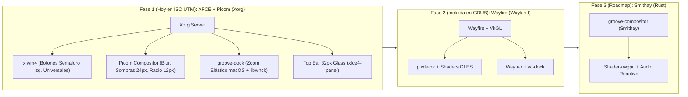

# Plan Híbrido por Fases: Escritorio Blue Note macOS Glass (XFCE + Picom → Wayfire → Smithay)

## Descripción del Objetivo

Construir e integrar un escritorio gráfico de alta gama inspirado en **macOS + Blue Note Glassmorphism**, resolviendo de raíz las limitaciones visuales observadas en Weston (decoraciones desiguales entre apps GTK y terminal, falta de desenfoque/sombras y dock estático), estructurado en un **Plan Híbrido de 3 Fases**:

- **Fase 1 (Implementación Inmediata hoy en ISO para UTM — Opción 1):**
  Sesión **XFCE 4.18/4.20 + Picom (Xorg)** con decoración universal de ventanas vía `xfwm4` (botones semáforo rojo/amarillo/verde a la izquierda en **todas** las ventanas), compositor **Picom** (esquinas redondeadas de 12px, sombras suaves de 24px, transparencias de cristal y desenfoque *dual-kawase* en GLX con fallback automático a Xrender), **Dock flotante (`groove-dock`) con magnificación/zoom elástico real** al pasar el cursor e indicadores de ventanas abiertas vía `libwnck-3.0`, y fondo predeterminado **Piano Keys Neon 4K**.
- **Fase 2 (Preservada y Conectada en la misma ISO — Opción 2):**
  Sesión **Wayfire + Waybar + wf-dock (Wayland Acelerado)** con shaders OpenGL ES / VirGL, efectos elásticos y cubo 3D, seleccionable desde GRUB y LightDM.
- **Fase 3 (Hoja de Ruta de Ingeniería — Opción 3):**
  Evolución de `groove-compositor` en **Rust + Smithay + wgpu** (Spec 008) con shaders WGSL propios y reactividad al motor de audio en tiempo real.



---

## Revisión Requerida del Usuario

> [!IMPORTANT]
> **1. Decoración Universal Semáforo a la Izquierda (`CHM|`):**
> En la Fase 1 (XFCE + Picom), tanto `xfwm4` (`button_layout=CHM|`) como GTK3 (`gtk-decoration-layout=close,minimize,maximize:menu`) usarán botones circulares estilo macOS a la **izquierda**:
> - Cerrar: Rojo `#FF5F56` (glifo `×` al pasar el cursor)
> - Minimizar: Amarillo `#FFBD2E` (glifo `–` al pasar el cursor)
> - Maximizar: Verde `#27C93F` (glifo `+` al pasar el cursor)
> Esto garantiza que **Thunar, Mousepad, xfce4-terminal, Firefox y cualquier diálogo** luzcan exactamente el mismo marco oscuro redondeado.

> [!NOTE]
> **2. Arranque Directo en UTM (`default=0` en GRUB):**
> La nueva ISO arrancará por defecto en la sesión **XFCE + Picom macOS Glass** con autologin seguro exclusivo para LiveUSB (`/run/groove/live`), para que al encender la VM en UTM entres directo al escritorio sin pasos extra, manteniendo en el menú GRUB las entradas para **Wayfire (Wayland 3D)**, **Selector LightDM**, **Weston** y **Consola de recuperación**.

---

## Cambios Propuestos — Fase 1 (Implementación Inmediata en ISO)

### 1. Compilación de Picom y Dependencias XCB en `/opt/groove-graphics`

Compilaremos desde fuentes en el contenedor `groove-graphical-build` las bibliotecas ligeras requeridas y el compositor **Picom**:
- `uthash` (cabeceras), `libev`, `libconfig`, `xcb-util`, `xcb-util-renderutil`, `xcb-util-image` y `picom`.
- Configuración en `/etc/xdg/picom.conf` con lanzador inteligente `/usr/libexec/groove-picom`:
  - Detecta si el driver DRI soporta aceleración GLX (`virtio_gpu_dri.so`) para activar `--backend glx --blur-method dual_kawase --blur-strength 6`; si la VM corre en modo framebuffer por software (`virtio-ramfb`), selecciona automáticamente `--backend xrender` manteniendo esquinas redondeadas (`corner-radius = 12`), sombras macOS (`shadow-radius = 24`), transparencias de cristal y animaciones de fade a 60 FPS sin penalizar la CPU.

#### [MODIFY] [recipes.json](file:///Volumes/HDEXTERNO/linux_groove/scripts/graphics/recipes.json)
#### [MODIFY] [sources.lock.json](file:///Volumes/HDEXTERNO/linux_groove/scripts/graphics/sources.lock.json)

---

### 2. Dock Nativo macOS con Magnificación/Zoom Real (`groove-dock`)

Reemplazaremos el panel inferior estático de XFCE (que en las capturas previas se veía como una caja gris rectangular) por un dock nativo en C compilado contra `gtk+-3.0`, `cairo` y `libwnck-3.0`:

#### [NEW] [groove-dock.c](file:///Volumes/HDEXTERNO/linux_groove/scripts/graphics/blue-note/groove-dock.c)
- **Ventana X11 tipo Dock (`GDK_WINDOW_TYPE_HINT_DOCK`)** con canal alfa RGBA real centrada en el borde inferior.
- **Efecto de Magnificación (Zoom Gaussiano a 60 FPS):**
  - Al mover el cursor sobre el dock, calcula la distancia euclidiana a cada icono:
    $$\text{scale}(d) = 1.0 + 0.42 \cdot \exp\left(-\frac{d^2}{2\sigma^2}\right)$$
  - El icono bajo el cursor crece suavemente de `44px` a `62px` y los iconos adyacentes se interpolan de forma continua, expandiendo dinámicamente la cápsula de vidrio (`rgba(16, 20, 30, 0.78)` con bisel especular `rgba(255, 255, 255, 0.24)`).
- **Integración con `libwnck-3.0` (Gestión Real de Ventanas X11):**
  - Muestra un **punto luminoso dorado (`#D4AF37`)** debajo de las aplicaciones que tienen ventanas abiertas y un punto azul neón (`#38BDF8`) bajo la aplicación activa.
  - Clic en icono:
    - Si no está abierta: lanza la app con animación de rebote vertical.
    - Si está abierta en segundo plano o minimizada: la restaura y enfoca (`wnck_window_activate`).
    - Si ya está activa: la minimiza suavemente (`wnck_window_minimize`).
- **6 Lanzadores Configurados con Iconos Squircle HiDPI:**
  1. **Terminal** (`xfce4-terminal`)
  2. **Archivos** (`Thunar`)
  3. **Editor** (`Mousepad`)
  4. **Navegador** (`Firefox ESR`)
  5. **Ajustes de Apariencia/Pantalla** (`xfce4-settings-manager`)
  6. **Sistema / Acerca de Groove** (`groove-system-info`)

---

### 3. Tema Universal de Ventanas `xfwm4` + Tema GTK3 Cupertino Blue Note Glass

Generaremos el tema completo de gestor de ventanas `/usr/share/themes/GrooveBlueNote/xfwm4/` y el CSS GTK3 unificado:

#### [NEW] [configure_xfce_macos.py](file:///Volumes/HDEXTERNO/linux_groove/scripts/graphics/configure_xfce_macos.py)
- **Generación de assets `xfwm4` (`/usr/share/themes/GrooveBlueNote/xfwm4/`):**
  - `themerc` con `button_layout=CHM|` (Cerrar, Minimizar, Maximizar a la izquierda y título centrado en color `#F4EFE6`).
  - Generación automática por SVG + `rsvg-convert` + máscaras XPM de bordes redondeados superiores (`12px`) y botones semáforo circulares (`#FF5F56`, `#FFBD2E`, `#27C93F`) en estados `active`, `prelight` (con símbolos `×`, `–`, `+`), `pressed` e `inactive`.
- **Configuración de Canales Xfconf (`/etc/xdg/xfce4/xfconf/xfce-perchannel-xml/`):**
  - `xfwm4.xml`: Activa el tema `GrooveBlueNote`, `button_layout=CHM|`, tipografía `DejaVu Sans Bold 10` y delega la composición a `picom`.
  - `xfce4-panel.xml`: Configura **únicamente la Barra Superior de 32px** en modo oscuro translúcido (`background-style=1`, `background-rgba=0.055,0.070,0.110,0.82`) con botón `🎷 Groove`, espacios de trabajo, reloj centrado y bandeja de sistema/sesión a la derecha. Elimina el panel 2 inferior por defecto.
  - `xfce4-desktop.xml`: Configura `/usr/share/backgrounds/groove-default.png` (el fondo **Piano Keys Neon 4K**) en todos los conectores posibles de Xorg/UTM (`monitor0`, `monitorVirtual-1`, `monitorVGA-1`, `monitorHDMI-1`, `monitorDefault`) con `image-style=5` (escala proporcional completa) y oculta los iconos sueltos del escritorio para lucir limpio como macOS.
  - `xsettings.xml` y `/etc/xdg/gtk-3.0/settings.ini`: Configura `Gtk/DecorationLayout = "close,minimize,maximize:menu"` para que cualquier diálogo o app con HeaderBar CSD también tenga los botones semáforo a la izquierda.
- **Autostart de Sesión (`/etc/xdg/autostart/`):**
  - `groove-picom.desktop`: Inicia `groove-picom` al arrancar XFCE.
  - `groove-dock.desktop`: Inicia `groove-dock` al arrancar XFCE.

#### [MODIFY] [configure_rootfs.py](file:///Volumes/HDEXTERNO/linux_groove/scripts/graphics/configure_rootfs.py)
#### [MODIFY] [configure_blue_note.py](file:///Volumes/HDEXTERNO/linux_groove/scripts/graphics/configure_blue_note.py)

---

### 4. Arranque Directo en GRUB y Empaquetado de ISO (`0.3.0-macos-glass`)

#### [MODIFY] [package_iso.sh](file:///Volumes/HDEXTERNO/linux_groove/scripts/graphics/package_iso.sh)
- Configurar LightDM para soportar autologin seguro en LiveUSB hacia `groove-xfce` (verificando `/run/groove/live` vía PAM `lightdm-autologin`) permitiendo también cerrar sesión para volver al selector LightDM y cambiar a Wayfire o Weston.
- Actualizar el menú de GRUB:
  1. `Linux Groove 0.3.0 - Blue Note macOS Glass (XFCE + Picom X11)` *(Predeterminado `default=0`)*
  2. `Linux Groove 0.3.0 - Blue Note Glass 3D (Wayfire Wayland)`
  3. `Linux Groove 0.3.0 - Weston (Wayland, recuperacion)`
  4. `Linux Groove - Consola de recuperacion`

---

## Trazado Arquitectónico — Fases 2 y 3 (Roadmap en Repositorio)

Actualizaremos [`docs/plans/DESKTOP_EVOLUTION_OPTIONS.md`](file:///Volumes/HDEXTERNO/linux_groove/docs/plans/DESKTOP_EVOLUTION_OPTIONS.md) con el plan de ejecución de las siguientes fases:

### Fase 2: Consolidación de Wayfire + Waybar + wf-dock (Wayland Acelerado)
- **Estado actual:** Binarios ya compilados en `/opt/groove-wayfire` e incluidos en la ISO bajo la opción 2 del menú GRUB (`groove.session=wayfire`) y en el selector LightDM.
- **Siguiente paso tras validar Fase 1:** Unificar la posición de los botones semáforo en `pixdecor` (`close,minimize,maximize` a la izquierda) y añadir efecto de escala en `wf-dock` mediante CSS/animación para paridad estética total con la Fase 1 cuando se ejecuta con aceleración GPU VirGL.

### Fase 3: Compositor Propio en Rust (`groove-compositor` con Smithay + Shaders wgpu — Spec 008)
- **Sub-etapa 3.1:** Backend DRM/KMS + `libseat` + `libinput` en `crates/groove-compositor` usando `smithay` para levantar una sesión Wayland real.
- **Sub-etapa 3.2:** Implementación de `xdg-shell` con Server-Side Decorations (SSD) dibujadas por el compositor (marco redondeado 12px y botones semáforo integrados).
- **Sub-etapa 3.3:** Pipeline de post-procesado en `wgpu` con shader de desenfoque *dual-kawase* en dos pasadas y barra/dock reactivos al bus de telemetría RT de audio (`groove-audio`).

---

## Plan de Verificación

### Pruebas Automatizadas en Contenedor y Chroot
1. Compilación limpia de `picom` y `groove-dock` contra `/opt/groove-graphics`:
   ```bash
   docker exec groove-graphical-build /opt/groove-graphics/bin/picom --version
   docker exec groove-graphical-build ldd /opt/groove-graphics/bin/groove-dock
   ```
2. Verificación de generación de assets `xfwm4` (`themerc`, PNGs y XPMs) y validación de configuraciones XML (`xfwm4.xml`, `xfce4-panel.xml`, `xfce4-desktop.xml`).
3. Auditoría completa de dependencias ELF (`audit_runtime.sh`), validación de grafos de servicios (`groove-init --check-services`), catálogo de sesiones LightDM (`session_catalog_check`) y prueba de seguridad PAM (`test_live_access.sh`).
4. Generación de la ISO en `/Volumes/Backup/linux_groove_terabit/iso/linux-groove-0.3.0-macos-glass-aarch64.iso` (y actualización de `linux-groove-0.2.0-preview.iso` / checksums SHA-256).

### Verificación Manual en UTM
1. Arrancar la ISO en UTM (ARM64 UEFI): entrará por defecto a **XFCE + Picom macOS Glass**.
2. Verificar que el fondo es la imagen **Piano Keys Neon**, la barra superior es translúcida de 32px y el dock inferior hace **zoom suave de los iconos al pasar el cursor**.
3. Abrir **Terminal, Archivos (Thunar), Editor (Mousepad) y Firefox** desde el dock y comprobar que **todas las ventanas** tienen el mismo marco oscuro redondeado con los **3 botones de semáforo (rojo, amarillo, verde) a la izquierda**, sombras suaves y puntos indicadores en el dock.
