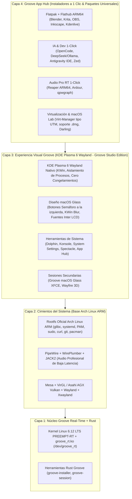

# Plan Maestro de Arquitectura: Linux Groove OS Studio Edition (Base Arch Linux ARM + Groove 3D + Flatpak + App Hub 1-Click)

**Proyecto:** Linux Groove OS 1.0 (Blue Note Edition)  
**Inspiración Arquitectónica:** Arquitectura Desacoplada e Inmutable de Alto Rendimiento  
**Hardware & Arquitectura Objetivo:** Apple Silicon (MacBooks M1, M2, M3, M4) y hardware ARM64 general (`aarch64`), compatible tanto en **UTM / Hypervisor nativo** como en **Bare Metal** (Asahi / m1n1 bootloader).

---

## 1. Visión General: El Modelo Groove Studio Adaptado a Mac Apple Silicon

La arquitectura de **Groove Studio** divide el sistema en 4 capas desacopladas sobre **Arch Linux ARM (`aarch64`)**: el sistema base es inmutable y sólido como una roca, mientras que el usuario tiene acceso instantáneo a aplicaciones profesionales mediante un **Groove App Hub (Instaladores a 1 Clic)** sin inflar la imagen ISO base.

---

## 2. Catálogo Oficial: "Groove App Hub" (Botones a 1 Clic)

Para que la ISO base se mantenga liviana (~1.8 GB a 2.5 GB) y ultra ágil, el sistema incluirá preinstaladas las herramientas esenciales (**Brave**, **OnlyOffice**, **Terminal**, **Thunar** y **Groove Control Center**) y un catálogo gráfico a 1 clic organizado por categorías:

### 🤖 A. Inteligencia Artificial y Desarrollo
* **OpenCode (`opencode.ai`)**: Asistente de IA para desarrollo en terminal. Con `curl` y stack oficial de Arch, se instala y actualiza con 1 solo clic.
* **Antigravity IDE (`aarch64`)**: IDE con IA y extensiones. El instalador gráfico configura sus librerías Electron (`nss`, `alsa-lib`, `mesa`), permisos y lanzador en el Dock.
* **DeepSeek Local / Harness**:
  * Botón para instalar **Ollama (Nativo ARM64)** con soporte para modelos `deepseek-r1` y `deepseek-coder`.
  * Integración con **DeepSeek CLI** y cliente web/gráfico local sin necesidad de internet.
* **VS Code / VSCodium ARM64** y **Zed Editor** (editor acelerado por GPU en Rust para ARM).

### 🎨 B. Modelado 3D, Video y Diseño Gráfico
* **Blender 4.x / 5.x (`aarch64`)**: Modelado y renderizado nativo ARM64 (repositorio oficial de Arch).
* **Krita**: Pintura digital e ilustración conceptual con aceleración por GPU.
* **Inkscape**: Diseño vectorial profesional (alternativa a Illustrator / Affinity Designer).
* **GIMP**: Retoque fotográfico profesional.
* **OBS Studio & Kdenlive**: Suite de grabación de pantalla y edición de video no lineal con aceleración por hardware.

### 🎵 C. Audio Profesional de Tiempo Real (Kernel Groove RT)
* **Reaper (ARM64 Nativo Oficial)**: DAW ultraligero y profesional para producción musical.
* **Ardour**: Estación de audio digital libre multipista.
* **qpwgraph / Helvum**: Conexión visual tipo cable modular para enrutar audio de micrófonos, sintetizadores y apps de baja latencia con PipeWire.
* **Audacity**: Edición rápida de pistas de audio y podcasts.

### 🖥️ D. Virtualización y Ecosistema Mac / Compatibilidad
* **Virt-Manager / QEMU-KVM (El equivalente nativo a UTM)**:
  * Permite crear máquinas virtuales directamente dentro de Groove OS usando virtualización nativa KVM por hardware.
* **Soporte Nativo de Archivos `.dmg` de Mac**:
  * Integración en `groove-package-installer` y Thunar para montar o descomprimir imágenes de disco `.dmg` de macOS con doble clic.
* **Capa de Compatibilidad Darling (Experimental)**:
  * Integración experimental del entorno **Darling** para ejecutar binarios Mach-O de macOS en Linux ARM64.

---

## 3. Qué Problemas Quedan Erradicados de Raíz

| Problema en la base LFS actual | Solución definitiva en la base Arch Linux ARM |
| :--- | :--- |
| `bash: curl: orden no encontrada` al instalar OpenCode | `curl`, `wget`, `git`, `ca-certificates`, `python`, `base-devel` certificados e instalados de fábrica. |
| `sudo: PAM error: Critical error` y `su: pam_start: error 26` | Stack PAM oficial de Arch Linux (`pambase`, `pam`, `sudo`, `polkit`) 100% configurado y testeado para el usuario `groove`. |
| Sin gestor de paquetes (`pacman` / `apt` inexistentes) | `pacman` oficial de Arch Linux ARM + `flatpak` (Flathub) listos para instalar miles de programas. |
| Incompatibilidad de binarios `x86_64` (como Blender intel) | Repositorio `aarch64` con software compilado exclusivamente para arquitectura ARM64 de Apple Silicon. |

---

## 4. Fases de Ejecución Paso a Paso

### Fase 1: Creación del Script de Descarga y Bootstrap Arch Linux ARM
- Crear `scripts/arch/build_arch_rootfs.sh`.
- Descargar y verificar el rootfs base oficial `ArchLinuxARM-aarch64-latest.tar.gz`.
- Inicializar `pacman-key` y configurar los espejos oficiales (mirrors) de Arch Linux ARM.
- Instalar paquetes fundamentales: `base`, `base-devel`, `sudo`, `curl`, `wget`, `git`, `ca-certificates`, `pipewire`, `wireplumber`, `mesa`, `xorg-server`, `xfce4`, `flatpak`.

### Fase 2: Configuración de Seguridad, PAM, Usuario y Flathub
- Crear el usuario `groove` (UID 1000) en los grupos `wheel`, `audio`, `video`, `realtime`.
- Configurar `/etc/sudoers.d/groove` con acceso completo sin errores de PAM.
- Añadir el repositorio oficial de **Flathub** (`flatpak remote-add --if-not-exists flathub https://dl.flathub.org/repo/flathub.flatpakrepo`).
- Configurar el comando `groove-readonly` (protección inmutable nativa) para proteger el sistema o desbloquearlo para desarrollo.

### Fase 3: Inyección de la Capa Exclusiva "Linux Groove OS"
- Inyectar nuestro **Kernel 6.12 LTS Groove RT** y el módulo **`groove_rt.ko`** (`/dev/groove_rt`).
- Instalar los binarios compilados de nuestros crates Rust (`groove-installer`, `groove-session`).
- Instalar las aplicaciones GTK3 CSD propias:
  - `groove-control-center` (con la nueva pestaña **App Hub 1-Click**).
  - `groove-transparency-settings`.
  - `groove-package-installer` (con soporte para `.tar.xz`, `.zip`, `.deb`, `.AppImage`, Electron y extracción de `.dmg`).
  - `groove-effects-dialog` y `groove-dock`.
- Aplicar la configuración unificada de estilo **`GrooveWindow`** (Cairo ARGB sin esquinas dentadas, fuentes `Inter` con subpíxel LCD).
- Añadir la sesión **Wayfire 3D** (cubo 3D, ventanas wobbly, blur).

### Fase 4: Pruebas Automatizadas de Calidad (Sanity Checks)
- Crear el script de verificación `scripts/arch/verify_arch_rootfs.sh` que ejecute dentro del rootfs:
  1. `sudo -u groove sudo true` (cero errores de PAM).
  2. `curl --version` y `pacman --version`.
  3. Carga y permisos del módulo `groove_rt.ko`.
  4. Ejecución de un script de prueba de OpenCode y lanzadores Electron.

### Fase 5: Generación de la ISO Final Híbrida (`0.4.0-studio-arch`)
- Empaquetar el rootfs en `rootfs.squashfs` con compresión ZSTD multinúcleo.
- Configurar GRUB EFI para arranque en Apple Silicon (UTM / Mac) y generar `linux-groove-0.4.0-studio-arch-aarch64.iso` en `/Volumes/Backup/linux_groove_terabit/iso/`.
