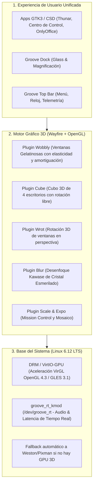

# Plan de Arquitectura: Unificación Total de GrooveWindow en Wayfire 3D

**Proyecto:** Linux Groove OS  
**Objetivo:** Eliminar la división entre sesiones (XFCE vs. Wayfire) y convertir a **Wayfire** en el compositor gráfico único y predeterminado del sistema operativo, permitiendo que el escritorio principal disfrute de **efectos 3D nativos (Cubo 3D, Ventanas Gelatinosas, Rotación y Cristal Esmerilado)** manteniendo la apariencia minimalista y herramientas de GrooveWindow.

---

## 1. Justificación y Visión Técnica

Actualmente el sistema mantiene dos sesiones gráficas separadas:
1. **XFCE (X11 / `xfwm4`)**: Ofrece el panel, el dock y las aplicaciones GTK3 estables, pero su arquitectura 2D impide renderizar deformaciones de mallas (ventanas gelatinosas) o proyecciones tridimensionales (cubo de escritorios).
2. **Wayfire (Wayland / OpenGL)**: Posee el motor de aceleración GPU por shaders (idéntico a Compiz), pero corría con una barra y configuración paralela.

**La Solución Unificada:**  
Fusionar ambos mundos: Wayfire se convierte en el **motor compositor único**, sobre el cual se ejecutan directamente el dock de Groove, el panel superior unificado, y todas las aplicaciones GTK3 (`Thunar`, `Centro de Control`, `OnlyOffice`, etc.) con aceleración por hardware directa en Wayland (vía `GDK_BACKEND=wayland,x11`).

---

## 2. Componentes y Especificaciones de la Unificación

### A. Decoración de Ventanas 3D Coherente (`pixdecor` + GTK CSD)
- Wayfire utilizará el plugin **`pixdecor`** configurado para que coincida exactamente con los tokens de **`GrooveWindow`** (`tokens.json`):
  - Fondo de cabecera: `#202124` / `rgba(32, 33, 36, 0.96)`
  - Esquinas superiores redondeadas: `radius = 10`
  - Botones minimalistas a la izquierda: Cerrar (`x`), Minimizar (`-`) y Maximizar (`+` / recuadro) con radio de 28 px y hover circular sutil.
  - Sombra difusa suave: `shadow_radius = 14`, `shadow_color = 0.0 0.0 0.0 0.45`.

### B. Calibración de Efectos 3D (Estilo macOS / Compiz Clásico)
1. **Ventanas Gelatinosas (`wobbly`)**:
   - `spring_k = 7.5` (rigidez equilibrada: elástico al mover, pero sin vibraciones molestas).
   - `friction = 2.8` (fricción fluida que amortigua la ventana al soltarla).
   - `grid_resolution = 8` (malla de deformación de alta definición para evitar polígonos visibles en curvas).
2. **Cubo 3D de Escritorios (`cube`)**:
   - 4 escritorios virtuales dispuestos en las 4 caras del cubo.
   - Atajos de teclado:
     - `Ctrl + Alt + Flecha Izquierda`: Rotar a la cara izquierda.
     - `Ctrl + Alt + Flecha Derecha`: Rotar a la cara derecha.
     - `Ctrl + Alt + Clic Izquierdo + Arrastrar`: Girar el cubo libremente en 3D en cualquier ángulo.
   - Zoom out: `zoom = 0.50`, iluminación OpenGL activa (`light = true`) y fondo nocturno Blue Note (`#0b0e14`).
3. **Rotación 3D de Ventanas (`wrot`)**:
   - `Ctrl + Alt + Clic Derecho sobre ventana + Arrastrar`: Inclina la ventana individual en perspectiva 3D (ideal para previsualización y multitarea).
4. **Cristal Esmerilado en Vivo (`blur`)**:
   - Algoritmo Kawase dual-filter con 3 iteraciones y offset 2.0.
   - Se aplica al fondo de menús, popovers, dock y ventanas traslúcidas.

### C. Shell y Paneles
- **Groove Top Panel**: Panel superior de 32 px integrado con el menú oficial de aplicaciones, reloj digital y telemetría de red.
- **Groove Dock**: Barra flotante inferior de acceso rápido con efecto cristal y magnificación.
- **Centro de Control**:
  - Incorpora el selector rápido de Efectos 3D (para alternar entre **Modo 3D Expresivo** y **Modo Reducido/Ahorro de Batería** con un solo clic).

---

## 3. Hoja de Ruta de Implementación (Paso a Paso)

| Paso | Tarea Técnica | Archivos Implicados | Resultado Esperado |
| :---: | :--- | :--- | :--- |
| **1** | **Unificar el Gestor de Sesión de LightDM** | `scripts/graphics/configure_rootfs.py` `/etc/lightdm/lightdm.conf` | El arranque predeterminado entra directamente a **Groove Wayfire 3D**. Si la máquina no tiene aceleración GPU VirGL, `groove-wayfire` conmuta suavemente a modo seguro sin pantallazo negro. |
| **2** | **Alinear `pixdecor` con `GrooveWindow`** | `scripts/graphics/wayfire/wayfire.ini` `configure_wayfire.py` | Las ventanas de Wayfire lucen exactamente iguales a las ventanas minimalistas de GTK3 (mismos botones, colores y curvatura suave). |
| **3** | **Integrar el Dock y Panel en Wayfire** | `scripts/graphics/wayfire/wf-shell.ini` `wayfire.ini` | `groove-dock` y el panel superior corren como superficies nativas de Wayland (`zwlr_layer_shell_v1`), manteniendo el fondo del piano 4K y sombras de cristal. |
| **4** | **Panel de Control 3D en el Centro de Control** | `groove-control-center.c` `groove-effects-dialog.c` | La opción "Efectos 3D" permite activar/desactivar la gelatina, ajustar la velocidad del cubo y probar las animaciones en vivo. |
| **5** | **Empaquetado y Verificación ISO** | `scripts/build_wayfire_iso.sh` `package_iso.sh` | Se genera la ISO definitiva con una única sesión gráfica de alto impacto visual y rendimiento ultra-fluido. |

---

## 4. Estado Actual y Continuación

- **Estado:** Planificado y guardado para ejecución en la siguiente iteración.
- **Pruebas en curso:** El usuario se encuentra validando la ISO **`0.3.0-rc22`** en UTM (verificando la resolución de bordes suaves CSD, fuentes LCD nítidas, editor de transparencias y OnlyOffice).
- **Ejecución de este plan:** Se iniciará tan pronto concluyan las pruebas del LiveUSB de `rc22`.
