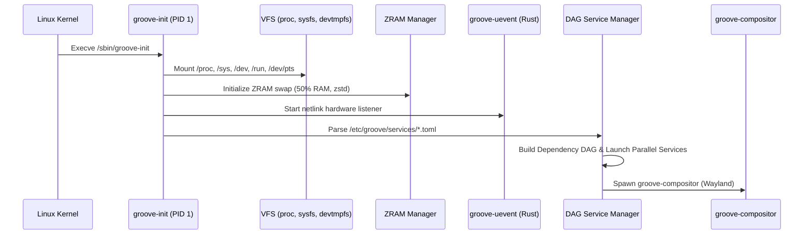

# Especificación Técnica 003: Rust Userspace & `groove-init` (PID 1)
*Documento de Diseño del Sistema — Spec-Driven Development (SDD)*

## Actualización de integración gráfica — 2026-11-04

Esta spec define el comportamiento objetivo de PID 1. El código anterior solo
lanzaba procesos y simulaba servicios ausentes; no implementaba la supervisión
indicada en el diagrama. La integración gráfica completa esa base.

Los manifiestos conservan sus campos existentes y añaden service.kind
(simple/oneshot), service.ready_path, service.timeout_ms y exec.console.
requires implica orden y disponibilidad; after solo ordena servicios presentes.
Un ciclo, dependencia requerida ausente, nombre duplicado o política inválida
impide iniciar el grafo. Un fallo real nunca cuenta como servicio listo.

El supervisor aplica UID/GID/grupos, limita reinicios, recoge hijos y termina
los grupos de procesos en orden inverso al apagar. Un daemon terminado no
satisface requires, aunque salga con código 0; un oneshot exitoso sí.
Servicios daemon escriben logs independientes; console=true conserva la consola.
--check-services DIRECTORY valida manifiestos sin montar ni iniciar servicios.

La sesión gráfica depende de dispositivos/D-Bus, no de PipeWire. single o
groove.text=1 selecciona manifiestos de recuperación. La disponibilidad de
un socket no sustituye una comprobación funcional del servicio.
Ver spec 007 y el tracker para estado y evidencia.

---

## 1. Alcance y Propósito

El userspace de **Linux Groove OS** prescinde por completo de `systemd` y `sysvinit`, reemplazándolos por un sistema de inicialización moderno, seguro en memoria y concurrente desarrollado en Rust: **`groove-init`**.

Asimismo, las herramientas de terminal estándar de GNU (`coreutils`, `grep`, `find`, `sudo`) son reemplazadas por sus contrapartes oficiales en Rust: **`uutils/coreutils`**, **`ripgrep`**, **`fd`**, **`bat`** y **`sudo-rs`**.

---

## 2. Ciclo de Vida de `groove-init` (PID 1)



---

## 3. Manifiestos de Servicio en TOML (`/etc/groove/services/*.toml`)

Ejemplo del servicio de audio en tiempo real `pipewire-rt.toml`:

```toml
[service]
name = "pipewire-rt"
description = "PipeWire Real-Time Audio Server"
after = ["dbus", "udev"]
requires = ["dbus"]
restart = "on-failure"
max_retries = 3

[exec]
command = "/usr/bin/pipewire"
user = "groove"
group = "groove-audio"
environment = { PIPEWIRE_LATENCY = "64/48000" }

[limits]
rt_priority = 98
memlock = "unlimited"
nice = -19
```

---

## 4. Gestión de Señales y Huérfanos
- **`SIGCHLD`:** `groove-init` implementa un loop con `waitpid(-1, &status, WNOHANG)` para evitar acumulación de procesos zombi.
- **`SIGTERM` / `SIGINT`:** Inicia el apagado ordenado cerrando primero los servicios hojas del DAG, desmontando discos de forma síncrona y ejecutando `sync()` y `reboot(LINUX_REBOOT_CMD_POWER_OFF)`.

