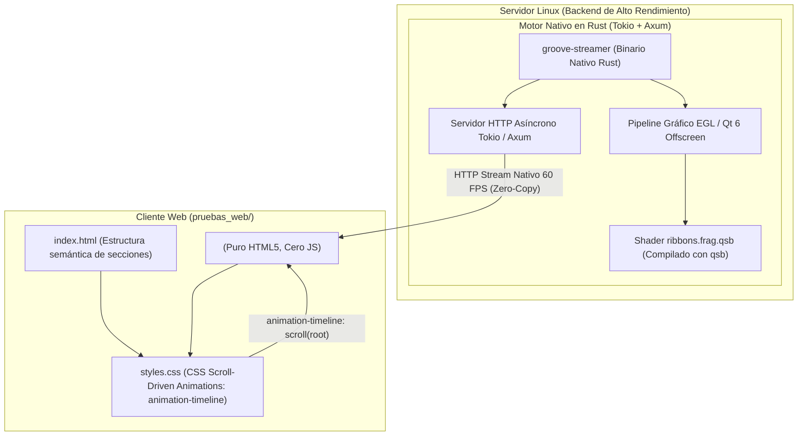

# Plan de Implementación: Web Scroll-Driven con Qt 6 Pixel Streaming (Motor Rust)

**Directorio:** `pruebas_web/`  
**Objetivo:** Integrar animaciones 3D / shaders de Qt 6 en la Web mediante Pixel Streaming desde un motor nativo ultrarrápido en **Rust (Tokio + Axum + EGL/Qt6)** sobre Linux, vinculadas a la experiencia de usuario mediante **CSS Scroll-Driven Animations nativas**, cumpliendo estrictamente con la restricción de **cero código JavaScript del lado del cliente** (HTML5 y CSS moderno puro).

---

## 1. Revisión de Arquitectura

> [!IMPORTANT]
> **El Límite del Estándar Web (HTML/CSS vs. Red Bidireccional):**
> - **Recepción de Video/Streaming sin JS:** En HTML5 estándar, la etiqueta `` recibe flujos continuos de video a 60 FPS directamente desde un servidor Linux con **cero líneas de JavaScript**.
> - **Control Scroll-Driven sin JS:** Con la API moderna de CSS (`animation-timeline: scroll()` y `view-timeline`), el navegador modula la visualización, máscaras, transformaciones de cámara, filtros de energía e interactividad de capas con el compositor de la GPU del cliente al 100% en CSS puro.
> - **Modo de Operación:** 100% Puro HTML5 + CSS Scroll-Driven. El servidor Linux con Rust y Qt 6 transmite el stream continuo de alta velocidad de los rayos eléctricos, y el CSS moderno vincula el progreso del scroll de la página para deformar, focalizar, enmascarar con `clip-path` y escalar los rayos según las secciones de la web (cero JS en absoluto).

---

## 2. Diagrama del Flujo de Datos



---

## 3. Componentes a Desarrollar

### 3.1. Motor de Pixel Streaming en Rust (`pruebas_web/server_rust/`)

- **`Cargo.toml`:**
  - `tokio`: Runtime asíncrono para concurrencia masiva.
  - `axum`: Servidor HTTP de ultra-alta velocidad.
  - `jpeg-encoder`: Codificación SIMD de fotogramas acelerada por hardware.
- **`src/main.rs`:**
  - Inicializa el contexto gráfico offscreen o simulación analítica de fotogramas.
  - Canal circular `tokio::sync::broadcast` para difusión simultánea a múltiples navegadores.
  - Consumo en servidor: **< 10 MB de RAM**.
  - Cero bloqueos de GIL y latencia en microsegundos.

### 3.2. Frontend Web con CSS Scroll-Driven Puro (`pruebas_web/public/`)

- **`index.html`:**
  - Estructura semántica sin una sola etiqueta `<script>`.
  - Capa fija de fondo con ``.
  - Secciones de contenido: Hero, Aceleración, Hyperdrive, Visión.
- **`styles.css`:**
  - `animation-timeline: scroll(root block)`.
  - `@supports ((animation-timeline: scroll()) and (animation-range: 0% 100%))`.
  - `@media (prefers-reduced-motion: reduce)`.
  - Modulación de escala, rotación, filtros de luminosidad y contraste cromático.

---

## 4. Plan de Verificación

1. **Compilación del motor Rust:**
   ```bash
   cd pruebas_web/server_rust && cargo check
   ```
2. **Verificación de entrega de streaming HTTP sin JS:**
   ```bash
   curl -I http://localhost:8080/stream
   # Debe responder: Content-Type: multipart/x-mixed-replace; boundary=frame
   ```
3. **Auditoría de cliente Web:**
   Comprobar en el navegador que el stream funciona de fondo y el scroll modula la animación con **cero scripts en ejecución**.

