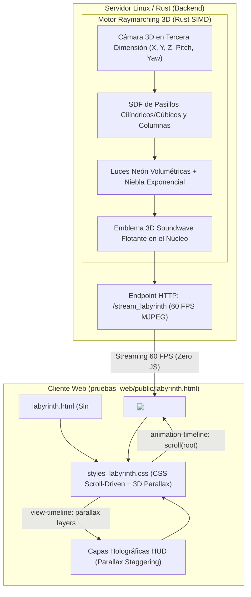

# Plan de Implementación: Laberinto 3D Cyberpunk Scroll-Driven con Pixel Streaming en Rust

## Resumen del Proyecto
Crear una segunda experiencia web inmersiva y de alta complejidad dentro de `pruebas_web/`: **un Laberinto 3D Cyberpunk** renderizado mediante **Raymarching volumétrico tridimensional** por el motor en **Rust**, donde el usuario navega a través de los pasillos, columnas de neón y curvas del laberinto en profundidad 3D al hacer scroll por la página, manteniendo la arquitectura de **cero JavaScript del lado del cliente** (HTML5 y CSS Scroll-Driven moderno puro con efectos de profundidad y parallax).

---

## Aspectos Clave del Diseño

> [!IMPORTANT]
> **Naturaleza del Movimiento 3D en el Scroll:**
> - **Avance Tridimensional por el Laberinto:** El shader de Raymarching en el servidor computa una cámara 3D que viaja por el espacio tridimensional recorriendo los pasillos del laberinto, esquivando columnas y doblando esquinas ante la profundidad.
> - **Efecto de Profundidad en el Frontend (Sin JS):** Mediante CSS Scroll-Driven Animations (`animation-timeline: scroll(root block)` y capas `parallax-scroll-effects`), el cliente web sincroniza el avance por el túnel con capas flotantes holográficas, deformación de campo de visión (*FOV Warp*), giros axiales y revelado cinemático de los sectores del laberinto.
> - **Ruta Dedicada:** El servidor en Rust sirve la nueva experiencia en `http://localhost:8089/labyrinth.html` con su flujo independiente en `/stream_labyrinth`, conviviendo de forma transparente con la web de los rayos eléctricos previa (`index.html`).

---

## Arquitectura del Laberinto 3D

---

## Componentes y Archivos

### Componente 1: Extensión del Motor en Rust (`pruebas_web/server_rust/src/main.rs`)

Añadir al binario `groove-streamer` el generador matemático de Raymarching 3D del laberinto y el endpoint `/stream_labyrinth`.

- **Renderizador de Raymarching 3D:**
  - Función `render_labyrinth_3d_frame(time, width, height)`:
    - Cámara 3D viajando por una trayectoria tridimensional curva:
      $$\vec{P}_{\text{cam}}(t) = \left( \sin(t \cdot 0.35) \cdot 1.2,\; \cos(t \cdot 0.25) \cdot 0.4,\; t \cdot 4.0 \right)$$
    - Función de Distancia Signada (SDF) para el laberinto: repetición periódica modular en el espacio de muros neón, columnas cilíndricas iluminadas y suelo cuadriculado reflectante con niebla volumétrica.
    - Iluminación difusa con normales analíticas, cálculo de oclusión ambiental y niebla volumétrica oscura con dispersión de luz cian, púrpura y ámbar.
- **Canal de Streaming Independiente:**
  - Canal `broadcast::channel::<Bytes>(16)` dedicado para `/stream_labyrinth`.
- **Nueva Ruta HTTP:**
  - `.route("/stream_labyrinth", get(stream_labyrinth_handler))`.

---

### Componente 2: Frontend Web del Laberinto 3D (`pruebas_web/public/`)

Diseño visual de alta gama inspirado en *Blade Runner* y la estética cyberpunk de *Linux Groove*.

#### Archivo `pruebas_web/public/labyrinth.html`
- **Estructura Semántica sin JavaScript:**
  - Viewport inmersivo con ``.
  - Cuadrícula HUD holográfica con brújula de profundidad, coordenadas de sector y telemetría de red.
  - 4 Sectores de exploración por scroll:
    1. **Sector 01: El Umbral Cibernético:** Entrada al laberinto de datos con perspectiva frontal.
    2. **Sector 02: Corredores de Neón:** Intersección tridimensional con columnas incandescentes.
    3. **Sector 03: Descenso al Núcleo:** Túnel vertical con rotación de cámara y aceleración.
    4. **Sector 04: El Santuario Soundwave:** El emblema blanco de Groove flotando en la cámara central.

#### Archivo `pruebas_web/public/styles_labyrinth.css`
- **CSS Scroll-Driven Animations Avanzadas:**
  - `animation-timeline: scroll(root block)` para controlar el acercamiento de la cámara 3D (`scale: 1.0` a `scale: 2.5`), la rotación en perspectiva (`rotateZ`), y el desenfoque de velocidad (*motion blur*).
  - Parallax multicapa (`parallax-scroll-effects`) con capas HUD que flotan a diferentes velocidades de desplazamiento usando `translateY` desfasado.
  - Detección de soporte `@supports ((animation-timeline: scroll()) and (animation-range: 0% 100%))`.
  - Modo seguro de accesibilidad `@media (prefers-reduced-motion: reduce)`.

---

## Verificación
1. Compilación del binario `groove-streamer` en release mode.
2. Comprobación de ambos endpoints (`/stream` y `/stream_labyrinth`) vía HTTP.
3. Comprobación de entrega de `labyrinth.html` y `styles_labyrinth.css`.
4. Extracción y validación de fotograma de prueba en JPEG del laberinto 3D.
